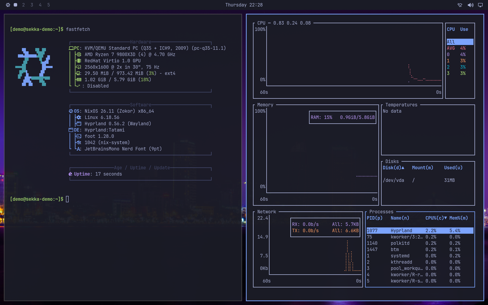

# Sekka 雪花

**A NixOS desktop you can install and look after through a graphical interface.**

Sekka brings together **Genkan**, a graphical installer; **Tatami**, a keyboard-driven desktop; and **Yukimi**, an app for managing software and system updates. It uses Determinate Nix and lets you choose Plasma, GNOME, Tatami, vanilla Hyprland, or Xfce—or install several and switch at login.

## Why you shouldn't use Sekka (yet)

Sekka is an early, experimental project. **It is not ready to be your dependable everyday operating system.** Try it in a disposable virtual machine or on a spare computer with nothing you need to keep.

- **Installation erases a whole disk.** There is no dual-boot setup, manual partitioning, or option to preserve an existing operating system. Keep backups elsewhere.
- **Disk encryption is not implemented.** Neither are RAID/LVM setup or offline installation. An internet connection is required.
- **Hardware coverage is limited.** Beyond its automated tests in virtual machines, Sekka runs on two laptops: it is in daily use on a Lenovo ThinkPad X1 Carbon Gen 14 with Intel graphics, external displays included, and tested by hand on an Acer Predator Helios Neo 14 with an NVIDIA GeForce RTX 4060 Laptop GPU and Intel graphics, switched with PRIME. That cannot establish that your Wi-Fi, graphics, sleep, or external displays work. Secure Boot is not a supported installation path. The current image targets x86_64 PCs; there is no ARM image.
- **Updates and recovery are still being exercised.** NixOS generations help you return to an earlier system, but they are not backups of your documents. Btrfs is available without automatic filesystem snapshots.
- **There is no production release or support promise.** Nightly images are previews, not a release you can rely on: their automated checks run in virtual machines, and a nightly may not have been tried on hardware yet. Older screenshots and test reports are not proof of a tested Sekka release.

If you need a system you can rely on today, wait before installing Sekka.

## A look around

Images below link to their original, full-resolution PNGs, captured at 2560 × 1600 with a scale of 2. Nothing is upscaled. They come from disposable test VMs built from Sekka's own modules, not from an installed release; see [screenshot provenance](docs/screenshots.md).

### Genkan: welcome home

Choose your disk, account, desktop, applications, and location. Review everything before confirming erasure. Genkan prepares the system while you review it, then copies the prepared system to disk.

[](docs/images/sekka/genkan.png)

*Current interface in preview mode, with sample data, on Sekka's Plasma session.*

The optional GitHub step can import your public SSH keys and set your Git identity. You can also carry your live session's Wi-Fi connections into the installed system.

### Tatami: a desktop under your fingertips

Tatami combines Hyprland with a compact bar, searchable application launcher and menus, notifications, display settings, and keyboard shortcuts. It takes inspiration from Omarchy and adapts the experience to NixOS.

Choose a wallpaper under **Style › Background**. **Style › Background settings**
lets you fill, fit, stretch, center or tile it, or use a solid color, with separate
choices for each display. Wallpapers keep their original resolution; your display
settings control any cropping.

For long downloads, builds, or overnight work, turn on **Keep Awake** using
the coffee cup in the bar or **Super + Ctrl + I**. It prevents sleep, automatic
screen locking, and lid-close sleep until you turn it off, and remembers your
choice at your next login. You can still lock the screen yourself. A red coffee
cup means protection could not be verified and needs attention.

Laptop displays behave the way a Mac's do. Close the lid with an external
display connected and the built-in display turns off, its windows move to the
other screen, and the laptop keeps running; open the lid and the built-in display
comes back where you arranged it. Unplug the last external display and the
built-in display turns on. A display you turn off in **Displays**
(**Super + Ctrl + D**) stays off whenever you reconnect the same displays, until
you turn it on again or log in again. If a display change leaves a window off
screen, Tatami brings it back, and **Super + Ctrl + D** always brings the Displays
window to the screen you are using.

Some differences remain. Unlike a Mac, the laptop also stays awake with its lid
closed while docked on battery power. It goes to sleep when you close the lid with no
other display connected, unless Keep Awake is on (then the built-in screen turns
off). Lid handling and docking are in daily use on the ThinkPad X1 Carbon Gen
14 with external displays, and virtual-machine tests with simulated displays and
a simulated lid guard them between changes.

Sekka also enables USB keyboard and mouse wake paths, including their parent
hubs. Waking from an intentional suspend still depends on the hardware and
firmware; try a key or mouse button if mouse movement does not wake it.

[](docs/images/sekka/tatami.png)

[](docs/images/sekka/tatami-menu.png)

### Yukimi: see and change your system

See what's installed and why, find software, check for updates, return to an earlier generation, and free up store space. Everyday changes do not require editing Nix configuration by hand.

[](docs/images/sekka/yukimi.png)

*Current application in Tatami, in a disposable NixOS test VM.*

### Prefer a familiar desktop?

Plasma is the default live desktop and the installer's preselected choice. GNOME and Xfce are available too. Multiple installed desktops share your account and one login screen.

[](docs/images/sekka/plasma.png)

[](docs/images/sekka/gnome.png)

## Trying Sekka

**There is no release yet, only a nightly ISO.** Each night, if `main` has changed and Sekka's automated checks pass, virtual-machine tests included, a new ISO for x86_64 PCs joins the last seven on [sekka.computer/download](https://sekka.computer/download/), each with its checksum and the source revision it came from. A nightly may not have been tried on hardware before it is published. Versioned releases will be prereleases on the [Releases page](https://github.com/bitemyapp/sekka/releases). Do not mistake GitHub's “Source code” archives for bootable images.

To put a nightly on a USB drive, [Kakehashi](apps/kakehashi/README.md) lists them, downloads and checks the one you pick, writes it, and reads every byte back, on Linux, macOS or Windows. On Sekka, install it from **Yukimi → Discover**. Kakehashi is new: so far it has written only virtual drives, and its macOS and Windows builds are GitHub workflow artifacts. Any tool that writes a raw disk image also works.

To build an image yourself, see [DEVELOPERS.md](DEVELOPERS.md). The image starts a live Plasma session with Genkan. The boot menu also offers an older kernel and an Xfce software-rendering recovery session. Check the live desktop on your hardware before considering installation.

Genkan currently offers ext4, Btrfs, or XFS, with UEFI or legacy BIOS boot. Optional RAM-sized swap and system tuning are enabled by default and can be switched off. Proprietary software is allowed by default with an opt-out; redistributable firmware may still be proprietary. The configured NVIDIA driver targets Turing and newer GPUs.

## Updating an existing installation

Open **Yukimi → Updates → Update** to get Sekka's newest nightly. It brings
NixOS, the applications and the AI tools at the versions that nightly built and
tested, and a nightly reaches you only once everything it needs is ready to
download. An update never compiles software on your computer, except NVIDIA's
driver, which is built for your kernel in a few minutes whenever either
changes. If space runs short, Yukimi stops before the disk fills up and
changes nothing. To update Sekka from a terminal, run:

```sh
sekka-update
```

Enter your administrator password when asked. Sekka downloads the update,
builds your system, and applies changes safely. When a restart or sign-out is
needed, Yukimi shows one completion message with a button to finish when you
are ready. A restart also finishes desktop changes; you will not be asked to
restart again for that same prepared update. Once preparation finishes,
Yukimi can be closed: the computer starts the prepared system on its next boot.
It never restarts or signs you out automatically.
Your account, installed applications, hardware configuration,
and desktop choices stay in place. Previous generations remain available in
Yukimi's History and the boot menu.

If your installation predates this command (including the original graphical
installer builds), run this once:

```sh
nix run github:bitemyapp/sekka/nightly#update
```

This also moves supported older installations from the separate Calamares,
Tatami, and Yukimi repositories to Sekka. After restarting, the command and
button above are available. If the build fails or you cancel before activation,
the updater restores the configuration files it changed.

The terminal command and Yukimi's Update button do the same. Sources you have
pointed somewhere of your own keep their own rows and update separately, and
may need building. Run `sekka-update --status` to check whether anything
remains to be applied.

When a check finds a newer Sekka, Yukimi also works out what it changes for
each of your packages, and **Choose packages…** lists them: new versions
first, then packages that keep their version but were built differently.
Untick one to keep running the build you have now; it stays exactly as it is
through later updates until you tick it again. Keeping a package keeps the
copy your system runs from its package list. If another part of the system,
such as a service or another application, needs the new version, the update
installs that too, and Yukimi says so when the update is done. Only packages
installed for everyone can be kept.

## Questions, bugs, and contributions

Please [open an issue](https://github.com/bitemyapp/sekka/issues) with what you tried, what happened, and the image version or source revision. Hardware details help with boot and display problems. Review logs for personal information before attaching them.

To work on the distro, start with [DEVELOPERS.md](DEVELOPERS.md). Tatami and Yukimi can also be used independently on NixOS through Sekka's individual modules.

## Credits and licenses

Sekka builds on NixOS, Determinate Nix, and many other free-software projects. Genkan originated as the NixOS-focused Rust implementation in our Calamares fork. Tatami is inspired by Omarchy. Sekka is not an official NixOS, Determinate Systems, Calamares, or Omarchy product.

Components retain their own licenses and attribution: Genkan is GPL-3.0-or-later; Tatami and Yukimi code is MIT OR Apache-2.0, with separately attributed configuration and artwork. See [NOTICE](NOTICE), [component provenance](docs/imports.json), and the license files in each component directory.
