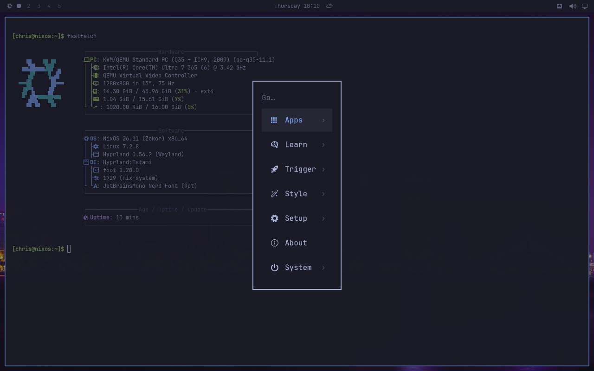
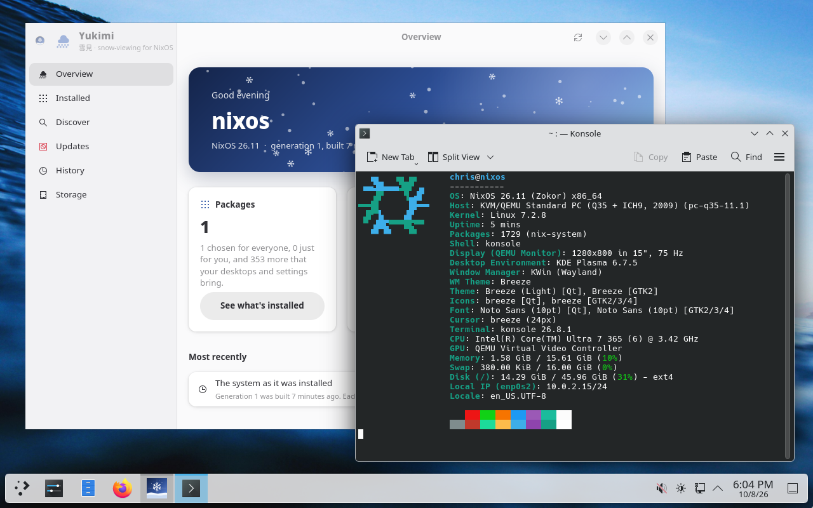
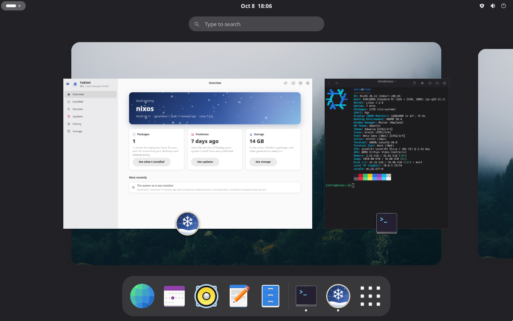

# Sekka 雪花

**A NixOS desktop you can install and look after through a graphical interface.**

Sekka brings together **Genkan**, a graphical installer; **Tatami**, a keyboard-driven desktop; and **Yukimi**, an app for managing software and system updates. It uses Determinate Nix and lets you choose Plasma, GNOME, Tatami, vanilla Hyprland, or Xfce—or install several and switch at login.

## Why you shouldn't use Sekka (yet)

Sekka is an early, experimental project. **It is not ready to be your dependable everyday operating system.** Try it in a disposable virtual machine or on a spare computer with nothing you need to keep.

- **Installation erases a whole disk.** There is no dual-boot setup, manual partitioning, or option to preserve an existing operating system. Keep backups elsewhere.
- **Disk encryption is not implemented.** Neither are RAID/LVM setup or offline installation. An internet connection is required.
- **Hardware coverage is limited.** VM tests cannot establish that your Wi-Fi, graphics, sleep, or external displays work. Secure Boot is not a supported installation path. The current image targets x86_64 PCs; there is no ARM image.
- **Updates and recovery are still being exercised.** NixOS generations help you return to an earlier system, but they are not backups of your documents. Btrfs is available without automatic filesystem snapshots.
- **There is no production release or support promise.** Automated ISO publication is deliberately disabled while the monorepo and release process are validated. Older screenshots and test reports are not proof of a tested Sekka release.

If you need a system you can rely on today, wait before installing Sekka.

## A look around

Images below link to their original, full-resolution PNGs. Nothing is upscaled. The desktop screenshots were captured from the predecessor image; see [screenshot provenance](docs/screenshots.md) for their source and the current app captures.

### Genkan: welcome home

Choose your disk, account, desktop, applications, and location. Review everything before confirming erasure. Genkan prepares the system while you review it, then copies the prepared system to disk.

[](docs/images/sekka/genkan.png)

*Current interface in preview mode, with sample data.*

The optional GitHub step can import your public SSH keys and set your Git identity. You can also carry your live session's Wi-Fi connections into the installed system.

### Tatami: a desktop under your fingertips

Tatami combines Hyprland with a compact bar, searchable application launcher and menus, notifications, display settings, and keyboard shortcuts. It takes inspiration from Omarchy and adapts the experience to NixOS.

Choose a wallpaper under **Style › Background**. **Style › Background settings**
lets you fill, fit, stretch, center or tile it, or use a solid color, with separate
choices for each display. Wallpapers keep their original resolution; your display
settings control any cropping.

[](docs/images/tour/installed-tatami-menu.png)

### Yukimi: see and change your system

See what's installed and why, find software, check for updates, return to an earlier generation, and free up store space. Everyday changes do not require editing Nix configuration by hand.

[](docs/images/sekka/yukimi.png)

*Current application running in a disposable NixOS test VM.*

### Prefer a familiar desktop?

Plasma is the default live desktop and the installer's preselected choice. GNOME and Xfce are available too. Multiple installed desktops share your account and one login screen.

[](docs/images/tour/installed-plasma.png)

[](docs/images/tour/installed-gnome.png)

## Trying Sekka

**Downloads are not available from an enabled Sekka release pipeline yet.** When previews are published, they will appear on the [Releases page](https://github.com/bitemyapp/sekka/releases), with checksums and instructions. Do not mistake GitHub's “Source code” archives for bootable images.

For now, building an image is a developer workflow; see [DEVELOPERS.md](DEVELOPERS.md). A built image starts a live Plasma session with Genkan. The boot menu also offers an older kernel and an Xfce software-rendering recovery session. Check the live desktop on your hardware before considering installation.

Genkan currently offers ext4, Btrfs, or XFS, with UEFI or legacy BIOS boot. Optional RAM-sized swap and system tuning are enabled by default and can be switched off. Proprietary software is allowed by default with an opt-out; redistributable firmware may still be proprietary. The configured NVIDIA driver targets Turing and newer GPUs.

## Updating an existing installation

Open **Yukimi → Updates → Update Sekka**, or run:

```sh
sekka-update
```

Enter your administrator password when asked. Sekka downloads the update,
builds your system, and prepares it for your next restart. It does not reboot
automatically. Your account, installed applications, hardware configuration,
and desktop choices stay in place. Previous generations remain available in
Yukimi's History and the boot menu.

If your installation predates this command (including the original graphical
installer builds), run this once:

```sh
nix run github:bitemyapp/sekka/main#update
```

This also moves supported older installations from the separate Calamares,
Tatami, and Yukimi repositories to Sekka. After restarting, the command and
button above are available. If the build fails or you cancel before activation,
the updater restores the configuration files it changed.

This updates Sekka itself. NixOS base packages and independently pinned
applications have their own updates on Yukimi's Updates page. To activate a
Sekka update immediately, use `sekka-update --switch`; kernel and desktop
changes can still need a restart.

## Questions, bugs, and contributions

Please [open an issue](https://github.com/bitemyapp/sekka/issues) with what you tried, what happened, and the image version or source revision. Hardware details help with boot and display problems. Review logs for personal information before attaching them.

To work on the distro, start with [DEVELOPERS.md](DEVELOPERS.md). Tatami and Yukimi can also be used independently on NixOS through Sekka's individual modules.

## Credits and licenses

Sekka builds on NixOS, Determinate Nix, and many other free-software projects. Genkan originated as the NixOS-focused Rust implementation in our Calamares fork. Tatami is inspired by Omarchy. Sekka is not an official NixOS, Determinate Systems, Calamares, or Omarchy product.

Components retain their own licenses and attribution: Genkan is GPL-3.0-or-later; Tatami and Yukimi code is MIT OR Apache-2.0, with separately attributed configuration and artwork. See [NOTICE](NOTICE), [component provenance](docs/imports.json), and the license files in each component directory.
