# Sekka 雪花

**A NixOS desktop you can install and look after through a graphical interface.**

Sekka brings together **Genkan**, a graphical installer; **Aizome**, its own desktop; **Tatami**, a keyboard-driven tiling desktop; and **Yukimi**, an app for managing software and system updates. It uses Determinate Nix and lets you choose Aizome, Plasma, GNOME, Tatami, vanilla Hyprland, or Xfce—or install several and switch at login.

## Why you shouldn't use Sekka (yet)

Sekka is an early, experimental project. **It is not ready to be your dependable everyday operating system.** Try it in a disposable virtual machine or on a spare computer with nothing you need to keep.

- **Installation erases a whole disk.** There is no dual-boot setup, manual partitioning, or option to preserve an existing operating system. Keep backups elsewhere.
- **RAID/LVM setup and offline installation are not implemented.** An internet connection is required.
- **Hardware coverage is limited.** Sekka is in daily use on a Lenovo ThinkPad X1 Carbon Gen 14 with Intel graphics, external displays included, and tested by hand on an Acer Predator Helios Neo 14 with an NVIDIA GeForce RTX 4060 Laptop GPU and Intel graphics, switched with PRIME. A desktop with an RTX 5090 also runs Aizome and is used for GPU component testing. That cannot establish that your Wi-Fi, graphics, sleep, or external displays work. Secure Boot is not a supported installation path. The current image targets x86_64 PCs; there is no ARM image.
- **Updates and recovery are still being exercised.** NixOS generations help you return to an earlier system, but they are not backups of your documents. Btrfs is available without automatic filesystem snapshots.
- **There is no production release or support promise.** Nightly images are previews, not a release you can rely on: their automated checks run in virtual machines, and a nightly may not have been tried on hardware yet. Older screenshots and test reports are not proof of a tested Sekka release.

If you need a system you can rely on today, wait before installing Sekka.

## A look around

Images below link to their original, full-resolution PNGs, captured with a scale of 2, at twice the density of the layout. Desktops are shown whole, and each application on its own, cropped to its window. Nothing is upscaled. They come from disposable test VMs built from Sekka's own modules, not from an installed release; see [screenshot provenance](docs/screenshots.md).

### Genkan: welcome home

Choose your disk, account, desktop, applications, and location. Review everything before confirming erasure. Genkan prepares the system while you review it, then copies the prepared system to disk. Genkan opens when the live session starts, and it is an Aizome app: it shares Aizome's look and menu bar, and follows its Night and Day themes.

[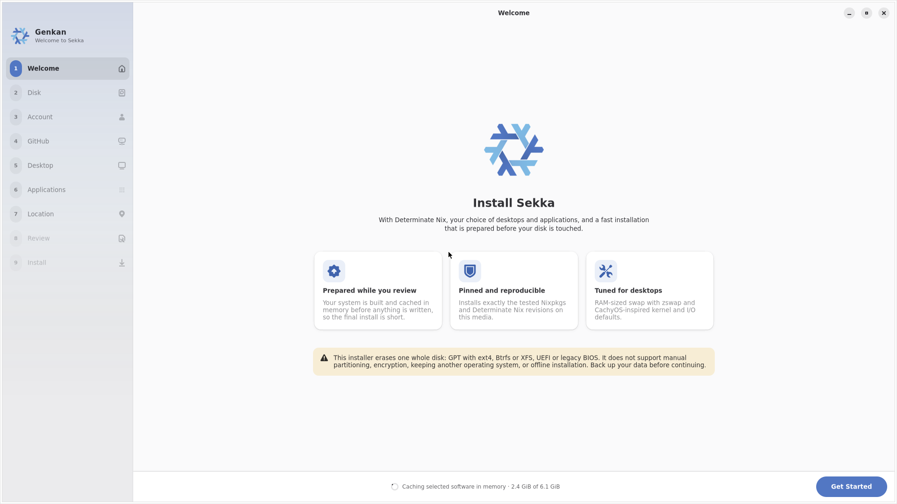](docs/images/sekka/genkan.png)

*Genkan's window in preview mode, with sample data, in Aizome.*

You can enable **LUKS2 disk encryption** on the disk page and choose a separate passphrase to unlock the system at startup. The system, personal files and optional swap are encrypted; boot files remain unencrypted. It works with ext4, Btrfs or XFS, using UEFI or legacy BIOS. Encryption is off by default. Remember the disk passphrase: changing your login password does not change it, and Genkan cannot recover it. TRIM is enabled through encryption to let SSDs reclaim space; this reveals which disk blocks are unused. Encrypted installation has not been validated on physical hardware.

Installed systems start behind Sekka's boot splash: the crest on the night ground, with a thin rail that fills as the computer starts, and "Restarting" or "Shutting down" when it stops. Press **Esc** at any time to see the boot messages, and **Esc** again to go back; after 15 seconds the splash reminds you. On an encrypted system you type the disk passphrase into the splash, which points out Caps Lock; one passphrase opens both the system and its swap. A system installed before the splash came keeps starting without it, and updating doesn't change that: turn it on in Aizome's **Settei → General → Startup**, or with `sekka-update --choose calamares.bootSplash.enable=true`, and it shows from the next start. The splash has been tested in virtual machines, not yet on physical hardware.

The optional GitHub step can import your public SSH keys and set your Git identity. You can also carry your live session's Wi-Fi connections into the installed system.

Choose **fish** among the applications, here or later in Yukimi, and your terminals open in the fish shell set up as Omarchy sets it up: Omarchy's Starship prompt, vi keys, `ls` as eza, a `cd` that falls back to zoxide, and fzf searches of your history (**Ctrl + R**), files (**Ctrl + Alt + F**), and Git log and status (**Ctrl + Alt + L**, **Ctrl + Alt + S**). Bash stays your login shell and runs scripts. Functions in your own `~/.config/fish` and a `~/.config/starship.toml` replace Omarchy's. Some of Omarchy's shortcuts call tools fish doesn't bring, such as tmux, ImageMagick, or ffmpeg, and `iso2sd` and `try` depend on Omarchy itself, so they don't work.

Programs built for other Linux distributions start as they would there. Editors and tools that download their own programs work without extra setup: Zed's language servers, debugger and AI agents, for example. These downloaded programs find the common libraries: the C and C++ runtimes, zlib, OpenSSL, curl, systemd and a few more. One that needs others, such as most graphical programs, still won't start, and neither will a script that asks for `/bin/bash`.

### Aizome: Sekka's own desktop

Aizome 藍染 is the desktop Sekka is made for, and the installer's preselected
choice. It is written from the compositor up in Rust, on its own native
toolkit, Sukumo 蒅, and takes its ideas from Haiku, NeXTSTEP and IRIX:

- Every window wears a tab only as wide as its title. Drop one tab on another
  and the windows stack into a group, from any apps; slide a tab along the
  top edge with **Shift**.
- One menu bar shows the focused app's menus. **Super + right-click**
  anywhere opens the whole menu at the pointer, and any menu tears off into
  a palette.
- **Super + Space** opens the command palette: every command in the focused
  app's menus, with its shortcut taught back to you, and windows, files,
  apps, settings and arithmetic.
- The Toolchest launches apps and places, the Deskbar lists each app with
  its windows and files its notifications beneath it, and Desks keep work
  apart (**Super + Ctrl + ↑** shows them all).
- **Super** is the command key in every app (**Super + C**, **Super + V**),
  and foot opens in fish.
- Browsers, Electron apps, Zed and Flatpaks open and save files in Aizome's
  own chooser: Files' sidebar and path bar over the app's window, with its
  filters and options. Qt apps, and GTK 4 apps that don't ask the desktop
  portal, still show their own dialogs.

It comes with its own apps: Settei (Settings), Yukimi, Hako (Files), Sumi
(Text Editor), Fusen (Notes), Koyomi (Calendar), Tokei (Clock), Soroban
(Calculator), Tenki (Weather), Tansu (Disks), Kura (Disk Usage), Myaku
(Activity), Shashin (Images) and Koe (Dictation). Aizome is new and its
hardware coverage is limited. See [its README](desktop/aizome/README.md)
for what is done and what isn't.

[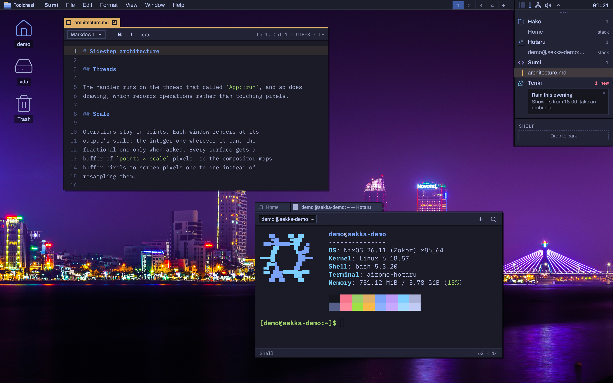](docs/images/sekka/aizome-desktop.png)

[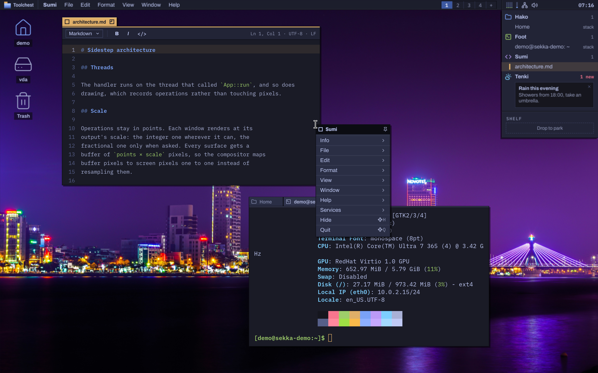](docs/images/sekka/aizome-menu.png)

[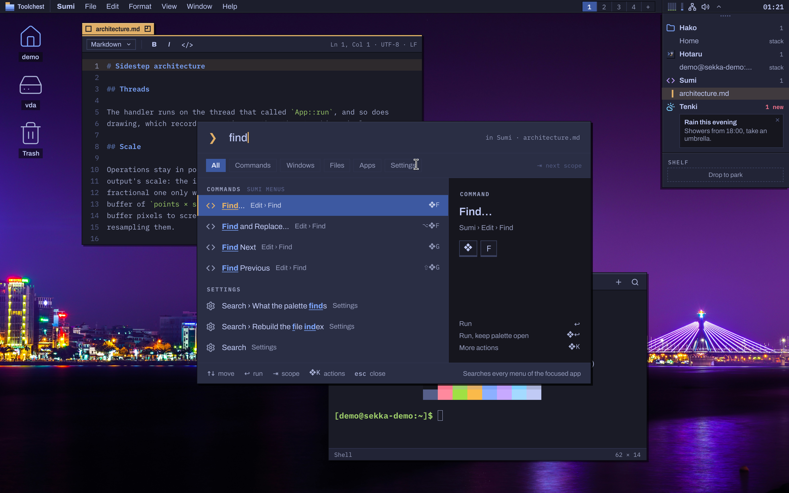](docs/images/sekka/aizome-palette.png)

[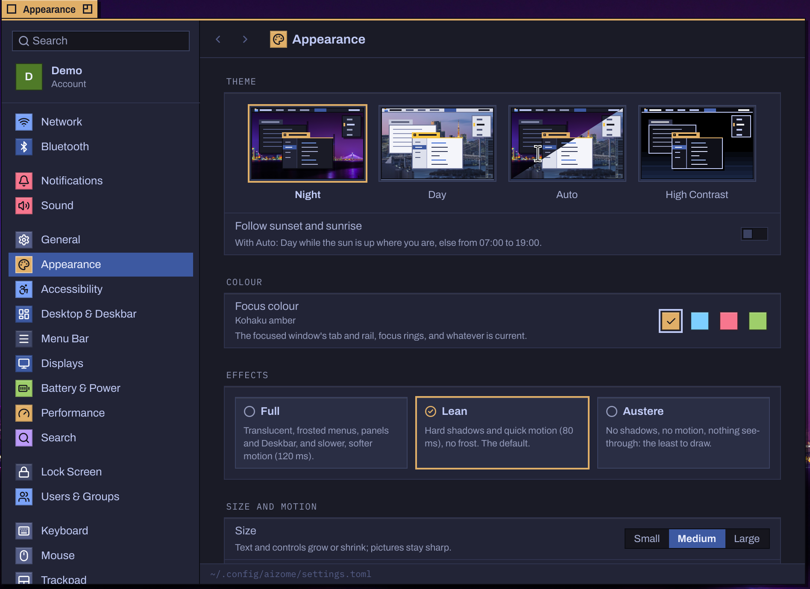](docs/images/sekka/aizome-settings.png)

*Aizome in a disposable NixOS test VM, rendering in software.*

### Tatami: a desktop under your fingertips

Tatami combines Hyprland with a compact bar, searchable application launcher and menus, notifications, display settings, and keyboard shortcuts. It takes inspiration from Omarchy and adapts the experience to NixOS.

[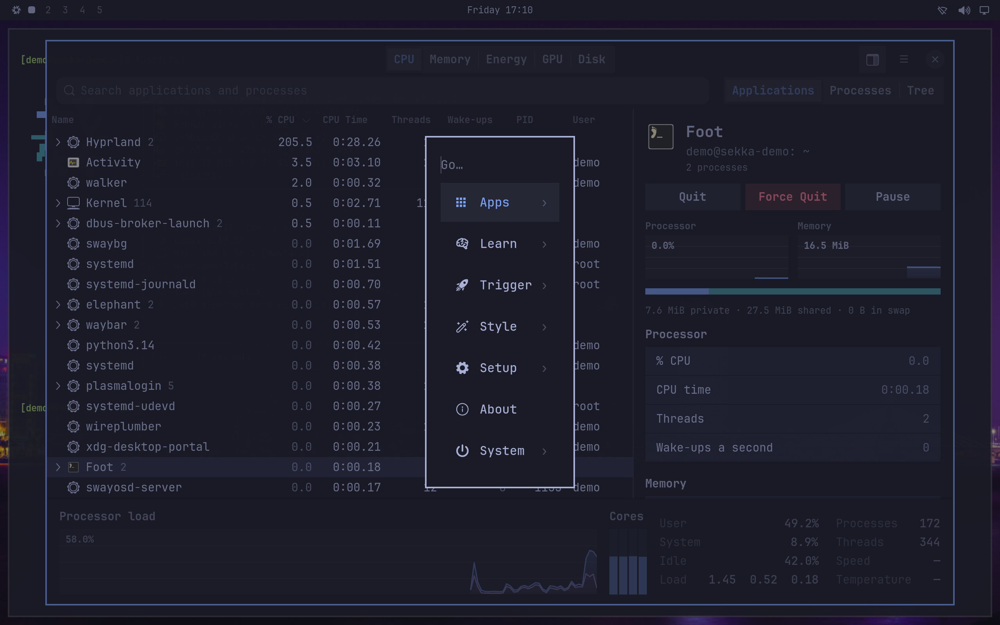](docs/images/sekka/tatami-menu.png)

Choose a wallpaper under **Style › Background**. **Style › Background settings**
lets you fill, fit, stretch, center or tile it, or use a solid color, with separate
choices for each display. Wallpapers keep their original resolution; your display
settings control any cropping.

For long downloads, builds, or overnight work, turn on **Keep Awake** using
the coffee cup in the bar or **Super + Ctrl + I**. It prevents sleep, automatic
screen locking, and lid-close sleep until you turn it off, and remembers your
choice at your next login. You can still lock the screen yourself. A red coffee
cup means protection could not be verified and needs attention.

To see what is using your computer, open **Activity** with **Super + Ctrl + T**.
Each application shows with all its processes together, and you can sort them
by processor, memory, estimated energy, graphics or disk use. Select one to
watch everything about it change, or quit one that misbehaves. Its energy
figures are estimates shared out from the processor's and graphics card's
meters; the window says what it can and can't measure.

[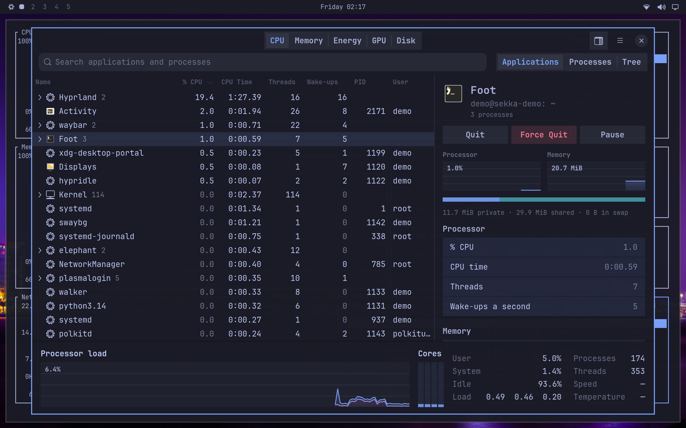](docs/images/sekka/activity.png)

[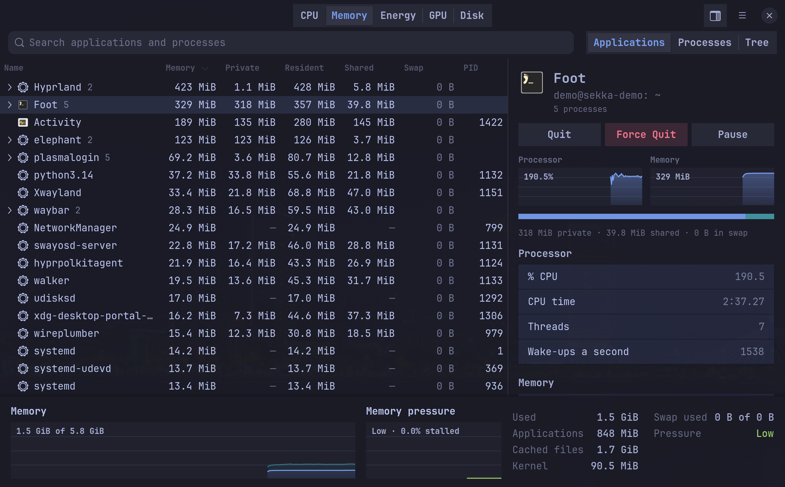](docs/images/sekka/activity-memory.png)

Laptop displays behave the way a Mac's do. Close the lid with an external
display connected and the built-in display turns off, its windows move to the
other screen, and the laptop keeps running; open the lid and the built-in display
comes back where you arranged it. Unplug the last external display and the
built-in display turns on. A display you turn off in **Displays**
(**Super + Ctrl + D**) stays off whenever you reconnect the same displays, until
you turn it on again or log in again. If a display change leaves a window off
screen, Tatami brings it back, and **Super + Ctrl + D** always brings the Displays
window to the screen you are using.

[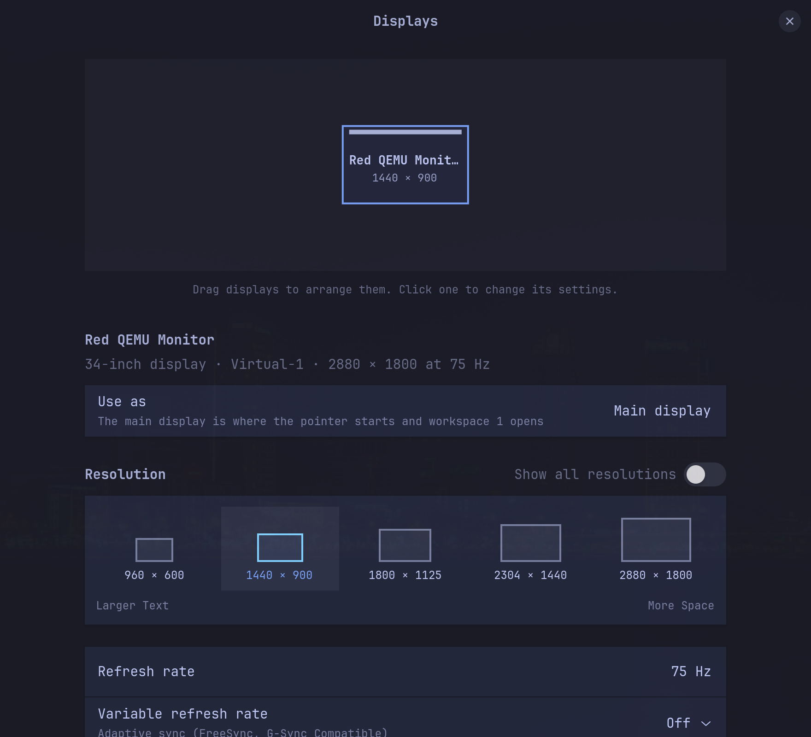](docs/images/sekka/displays.png)

Some differences remain. Unlike a Mac, the laptop also stays awake with its lid
closed while docked on battery power. It goes to sleep when you close the lid with no
other display connected, unless Keep Awake is on (then the built-in screen turns
off). Lid handling and docking are in daily use on the ThinkPad X1 Carbon Gen
14 with external displays, and virtual-machine tests with simulated displays and
a simulated lid guard them between changes.

Sekka also enables USB keyboard and mouse wake paths, including their parent
hubs. Waking from an intentional suspend still depends on the hardware and
firmware; try a key or mouse button if mouse movement does not wake it.

### Yukimi: see and change your system

See what's installed and why, find software, check for updates, return to an earlier generation, and free up store space. Everyday changes do not require editing Nix configuration by hand.

Every desktop uses Aizome's native Yukimi. It opens directly on Wayland and
inside a nested Wayland window on X11. Commands use Ctrl in Tatami and the
other desktops, and Super in Aizome.

[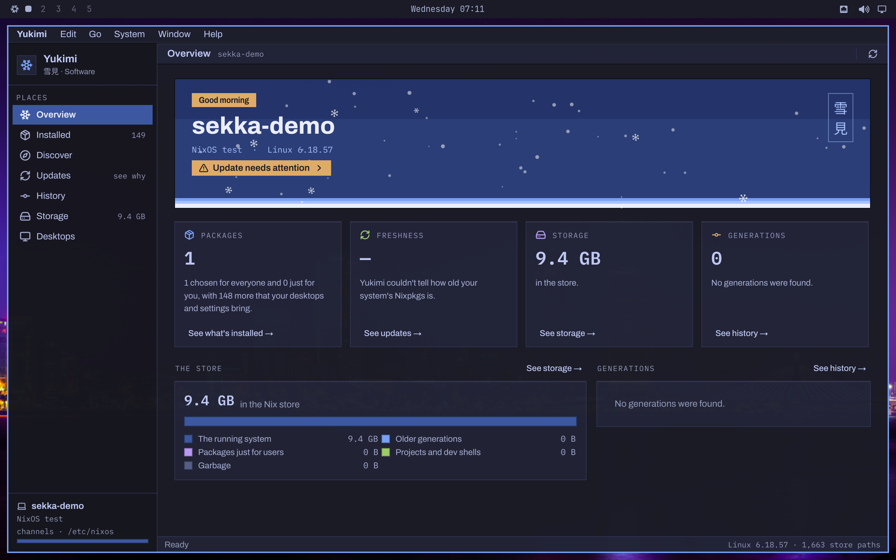](docs/images/sekka/yukimi.png)

*Current application in Tatami, in a disposable NixOS test VM.*

### Prefer a familiar desktop?

Plasma, GNOME and Xfce are available too. Multiple installed desktops share your account and one login screen: Aizome's own when Aizome is installed, listing every desktop you chose, and GDM when GNOME is, since GNOME locks its screen only under GDM (`calamares.loginScreen` chooses otherwise).

[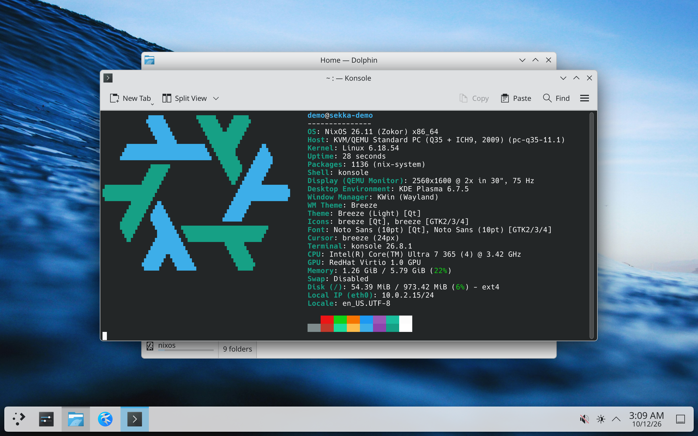](docs/images/sekka/plasma.png)

[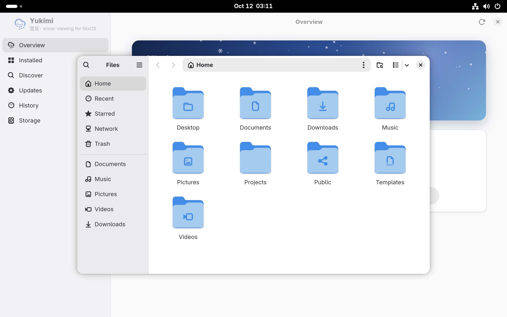](docs/images/sekka/gnome.png)

*This GNOME capture predates Yukimi's shared native interface.*

### Playing games

Install Steam through Genkan or Yukimi. Games with desktop shortcuts appear
under **Toolchest → Applications → Games** in Aizome. Steam also adds a
separate **Steam** login session, using Gamescope with adaptive sync and HDR
on capable displays. GE-Proton is available in Steam's compatibility menu;
choose it for individual games that need it.

For a game to request GameMode while it runs, set its Steam launch options
to `sekka-game -- %command%`. Use `sekka-game --hud -- %command%` to show
frame times and GPU usage, or add `--gamescope` to run it inside Gamescope.
There is no need to nest Gamescope inside the Steam login session; the
launcher detects it.

Aizome supports explicit synchronization for NVIDIA games and adaptive sync
under **Settings → Displays**, with fullscreen-only operation by default.
If a display flickers with adaptive sync, select **Off**. Aizome still
displays SDR and does not support tearing; use the Steam login session for
those features. HDR, VRR and tearing still need physical display and game
validation on each machine; GPU protocol tests alone do not establish them.

## Trying Sekka

**There is no release yet, only nightly ISOs.** An ISO for x86_64 PCs is published only after that exact image has been installed and used in virtual machines: installing, booting the installed system, logging in and using its desktops. That doesn't happen every night, so the newest ISO can be older than the newest update, and an installation catches up with its first update. Each published ISO joins the last seven on [sekka.computer/download](https://sekka.computer/download/), with its checksum and the source revision it came from. A nightly may not have been tried on hardware before it is published. Versioned releases will be prereleases on the [Releases page](https://github.com/bitemyapp/sekka/releases). Do not mistake GitHub's “Source code” archives for bootable images.

To put a nightly on a USB drive, [Kakehashi](apps/kakehashi/README.md) lists them, downloads and checks the one you pick, writes it, and reads every byte back, on Linux, macOS or Windows. On Sekka, install it from **Yukimi → Discover**. Kakehashi is new: so far it has written only virtual drives, and its macOS and Windows builds are GitHub workflow artifacts. Any tool that writes a raw disk image also works.

To build an image yourself, see [DEVELOPERS.md](DEVELOPERS.md). The image shows Sekka's boot splash (Esc shows the boot messages), then starts a live Aizome session with Genkan open. The boot menu also offers an older kernel and a recovery entry that draws the same Aizome session in software, without a GPU driver for NVIDIA graphics. Check the live desktop on your hardware before considering installation.

Genkan currently offers ext4, Btrfs, or XFS, with UEFI or legacy BIOS boot. Optional RAM-sized swap and system tuning are enabled by default and can be switched off. Proprietary software is allowed by default with an opt-out; redistributable firmware may still be proprietary. The configured NVIDIA driver targets Turing and newer GPUs.

Native 4 KiB sector disks require booting the installation media in UEFI mode.
Legacy BIOS installation requires 512-byte logical sectors, including 512e disks.

## Updating an existing installation

Open **Yukimi → Updates → Update** to get Sekka's newest nightly. It brings
NixOS, the applications and the AI tools at the versions that nightly built and
tested, and a nightly reaches you only once everything it needs is ready to
download. An update never compiles software on your computer, except NVIDIA's
driver, which is built for your kernel in a few minutes whenever either
changes. If space runs short, Yukimi stops before the disk fills up and
changes nothing. To update Sekka from a terminal, run:

```sh
sekka-update
```

Enter your administrator password when asked. Sekka downloads the update,
builds your system, and applies changes safely. When a restart or sign-out is
needed, Yukimi shows one completion message with a button to finish when you
are ready. A restart also finishes desktop changes; you will not be asked to
restart again for that same prepared update. Once preparation finishes,
Yukimi can be closed: the computer starts the prepared system on its next boot.
It never restarts or signs you out automatically. Adding or removing a desktop
doesn't make an update wait for a restart; the login screen lists the change
after your next one. An update that changes how the login screen starts a
desktop still waits, since until then the login screen would start its
previous version.
Your account, installed applications, hardware configuration,
and desktop choices stay in place. Previous generations remain available in
Yukimi's History and the boot menu.

If your installation predates this command (including the original graphical
installer builds), run this once:

```sh
nix run github:bitemyapp/sekka/nightly#update
```

This also moves supported older installations from the separate Calamares,
Tatami, and Yukimi repositories to Sekka. After restarting, the command and
button above are available. If the build fails or you cancel before activation,
the updater restores the configuration files it changed.

The terminal command and Yukimi's Update button do the same. Sources you have
pointed somewhere of your own keep their own rows and update separately, and
may need building. Run `sekka-update --status` to check whether anything
remains to be applied.

To get changes before the nightly does, turn on **Early updates** in
Yukimi's Updates page, or run `sekka-update --early`. Updates then
follow Sekka's `main` branch as soon as changes are merged, before the
nightly checks run, and anything the binary cache doesn't have yet builds on
your computer. `sekka-update --nightly` goes back.

Which desktops are installed, which one starts by default, the login
screen and the boot splash can be changed after installing too: in Aizome's
**Yukimi → Desktops**, or with `sekka-update --choose`, such as
`sekka-update --choose calamares.loginScreen=aizome`. Yukimi asks for your
password, builds the new system, and offers a restart when the change needs
one, as an update does.

## Questions, bugs, and contributions

Please [open an issue](https://github.com/bitemyapp/sekka/issues) with what you tried, what happened, and the image version or source revision. Hardware details help with boot and display problems. Review logs for personal information before attaching them.

To work on the distro, start with [DEVELOPERS.md](DEVELOPERS.md). Tatami and Yukimi can also be used independently on NixOS through Sekka's individual modules.

## Credits and licenses

Sekka builds on NixOS, Determinate Nix, and many other free-software projects. Genkan originated as the NixOS-focused Rust implementation in our Calamares fork. Tatami is inspired by Omarchy. Sekka is not an official NixOS, Determinate Systems, Calamares, or Omarchy product.

Components retain their own licenses and attribution: Genkan is GPL-3.0-or-later; Tatami and Yukimi code is MIT OR Apache-2.0, with separately attributed configuration and artwork. See [NOTICE](NOTICE), [component provenance](docs/imports.json), and the license files in each component directory.
