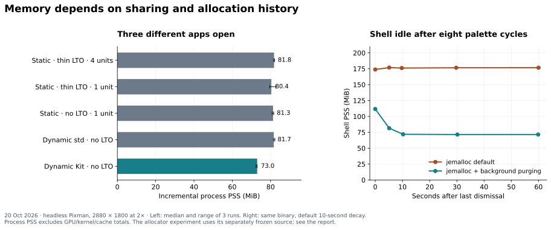

# Memory experiments — 20 October 2026

For continuation on another machine, see the [handoff and next experiments](memory-handoff.md).

This investigation separates live allocations, allocator-retained pages,
shared buffers, and shared executable code. Reducing one does not necessarily
reduce the others. The most useful source changes were a prepared-image
lifetime fix and a smaller wallpaper decode intermediate. Compiler and
allocator alternatives were tested in isolated builds rather than enabled
throughout the desktop.



## Scope and measurement

The compiler/linkage baseline is commit
`e75c905dd04535796792ff0862af0210ee175e01`, with the flake's pinned Sidestep
`dae957e913376a26e642d6abee533eb755fb9092`,
Rust 1.98.1 (`48a229cea`, LLVM 21.1.8), on an AMD Ryzen 7 9800X3D with 16
logical CPUs and approximately 64 GiB RAM. This is **not** the environment
of the supplied earlier report: that report measured installed `35f3015`,
about 31 GiB physical RAM, an Intel Xe GPU, and an aged desktop session.
Its absolute totals cannot be subtracted from these new measurements.

GUI measurements use a separate headless Pixman compositor, pinned to
installed `fcdb02f`, with a 2880 × 1800 output at 2×. Each run has private
runtime/config/cache directories. The real desktop was not restarted or
reconfigured. The three-app workload is a blank Soroban, blank Sumi, and
Settei's deterministic `--sample` view, at their default window sizes.
Memory runs use the host's Fontconfig configuration; the CPU frame tests
below explicitly pin Aizome's font directory.
Compositor and client PSS are added so both sides of Wayland buffers count.
The primary result is that sum minus the empty compositor's PSS. Three
samples follow a five-second warmup; variants run in alternating order
across three repetitions. Screenshots are taken **after** those samples;
post-close compositor measurements can include screenshot readback buffers
and are not used to claim release of app memory.

PSS is process memory, not whole-system consumption. It excludes unmapped
file cache, kernel metadata and GPU allocations outside process mappings.
Shared-library pages also mapped by unrelated processes are apportioned
outside this selected process set. No claim here is a prediction of the
machine's free-RAM counter. The software renderer deliberately removes GPU
driver variability; repeat on the real graphics backend before making a
GPU-inclusive desktop budget.

Measurements were serialized with `/tmp/aizome-benchmark.lock`, shared with
the other active development chat. Memory sampling overlapped some builds;
frame timing waited for compilation to finish. Build wall times under that
contention are not a compiler-performance comparison.

## Changes retained

### Prepared images: fix ownership through the first submitted frame

Kit's ahead-of-time rendering stored a hidden window's picture. During the
first draw callback, removing that picture dropped its images and queued
`ForgetImages`. Sidestep queued the current `Paint` only after the callback
returned. Consequently `Paint` put the now-ownerless image pixels back into
the renderer cache. Repeated palette openings accumulated approximately
5.3 MiB per cycle, eventually bounded by the image cache's budget.

Kit now keeps the picture's owner through the displayed window's lifetime,
until hide, replacement, or close. Its first-frame flag is consumed once;
later frames repaint their widgets normally. This preserves the fast
prepared opening and prevents stale-pixel replay. The existing hidden-window
integration test checks drawing and invalidation, and a focused regression
test checks owner lifetime and single use.

Heaptrack captures after eight palette cycles showed retained
offscreen image pixels falling from **44.70 MB to 5.59 MB**. Total live heap
fell from **73.10 MB to 34.02 MB**. These are Heaptrack's decimal MB, not MiB,
and allocations still live when the capture ended, not automatically leaks.
Instrumented RSS/timing is not used as normal-session performance evidence.
This attribution capture used the intermediate build that also shrank the
loaded index, before that shrink was rejected below. The index had been
dropped before the final sample; the image-stack attribution is direct.
The baseline shell also had extra Unicode-regex features from a grouped
app build. Therefore whole-process comparisons from those captures are
exploratory. Uninstrumented final-source measurements use matched features
and are reported separately.

In the final, uninstrumented current-index pair, both builds used the same
shell-only dependency features and a pinned 24,371-entry cache. After eight
palette cycles, shell PSS was **98.91 MiB before and 96.80 MiB after**;
anonymous PSS was 74.10 and 71.57 MiB. Thus this run did **not** return the
whole live-cache reduction to the OS. Allocator retention makes those
metrics diverge, as the experiments below demonstrate. Earlier larger PSS
improvements were excluded when feature/input changes or overlapping test
processes were found; they are not the reported final-source result.

Two final repetitions with the synthetic 230,772-entry cache likewise had
overlapping resident ranges: **155.94–169.02 MiB before**, and
**153.99–159.29 MiB after**. Anonymous PSS was 130.65–143.72 and
128.91–134.03 MiB respectively. The source fix prevents accumulation of
live image pixels; it does not by itself promise the same reduction in
resident pages. On the final source, fixing glibc's mmap threshold at
128 KiB brought this workload to **62.59 MiB PSS / 37.34 MiB anonymous PSS**,
remaining flat for 60 seconds. That is a separate allocator-policy result,
with responsiveness checks below.

### Wallpaper: resize RGB before creating output RGBA

For RGB JPEGs, the shell now filters the decoder's RGB pixels directly and
adds opaque alpha only to the output. It preserves the existing dimension
and allocation guards, orientation handling, filter and crop. Other formats
retain the original decode path. This avoids a full-size RGBA conversion
alongside the JPEG decoder's RGB allocation.

Seven alternating pairs (seven runs per implementation) of the configured
large wallpaper, with compilation stopped, measured peak live allocation falling from
**198.73 to 174.51 MiB** and median operation time from **264.20 to
203.99 ms** (about 23% faster). Observed time ranges were 258.21–267.24 and
202.75–208.67 ms. One pair affected by background CPU activity was replaced.
Both configured wallpapers produced identical output
across all 5,184,000 pixels at the tested display size. Tests additionally
cover all eight EXIF orientations, grayscale JPEG, alpha and 16-bit PNG,
upscaling and cropping. Whole-shell Heaptrack startup peak fell from
214.27 to 188.89 decimal MB.

### Release builds and optional symbols

`aizome-dev` now uses the normal optimized profile instead of silently
building reloadable logic at opt-level 1 with 64 codegen units. New package
metadata records `release-lto` for standalone shell/apps while compositor
logic retains the running core's compatible profile. The old `--optimised`
flag remains accepted. Older package metadata and debug compositor sessions
keep their recorded compatible profiles.

The Nix package exposes `aizome-debug`, the split symbols from the **same
derivation** as its runtime output. [Profiling instructions](profiling.md)
cover raw Heaptrack capture, deferred interpretation, source locations,
and isolated compositor/shell profiling. `scripts/aizome-memory` gives a
read-only PSS/anonymous/file/SHM breakdown without instrumentation.

DWARF is normally not mapped into an application's running address space.
Splitting it makes symbol downloads optional rather than adding them to
the runtime closure; it does not remove a resident heap cost. The existing
installed Nix app already lacks the large DWARF sections: the new output
preserves matching symbols for profiling instead of discarding them.
In three unstripped Cargo-built executables,
stripping debug data reduced disk size from 47.58/56.43/93.15 MB to
13.32/16.12/25.62 MB while leaving every ELF LOAD segment unchanged. Mapped
unwind tables are distinct; compositor panic recovery still needs unwinding.
Release symbols use line tables, sufficient for source stacks rather than
full local-variable inspection.

## Compiler and native Rust dynamic linkage

The existing release profile uses four codegen units. The thin-LTO
comparison changes only that to one. A separate three-arm comparison uses
one codegen unit and no cross-crate LTO: static Rust dependencies, dynamic
Rust standard library only, and a native Rust `dylib` for Aizome Kit. These
are actual app builds, with no C-FFI toolkit wrapper. Cargo dependency
features and frozen binary/library pairs are preserved for each arm.

| Build | Three-app incremental PSS, MiB | Observed range | Solo Soroban increment, MiB |
|---|---:|---:|---:|
| Existing static, thin LTO, 4 codegen units | 81.81 | 81.55–82.10 | — |
| Static, thin LTO, 1 codegen unit | 80.40 | 79.49–82.75 | 19.93 |
| Static, no LTO, 1 codegen unit | 81.28 | 80.76–81.62 | 20.30 |
| Dynamic standard library, no LTO, 1 codegen unit | 81.67 | 81.56–82.23 | — |
| Dynamic Kit, no LTO, 1 codegen unit | 73.00 | 72.38–73.00 | 25.87 |

Values are medians of three repetitions, each using its median of three
samples. Solo ranges were 19.80–19.94, 20.01–20.33 and 25.87–25.88 MiB
respectively. Kit sharing saved about **8.3 MiB** against its no-LTO static
control for three different apps, while costing **5.6 MiB more** for a lone
Soroban. Standard-library-only sharing did not produce a useful saving.
One codegen unit saved about 1.4 MiB in the median thin-LTO workload, with
overlapping ranges; this is not a compelling universal improvement.

Six additional alternating fresh-shell runs (20 seconds, no palette cycles)
used identical copied config/index hashes and the same grouped build
features. Median shell PSS was **64.11 MiB with four codegen units**
(62.28–65.21) and **65.13 MiB with one** (64.17–65.58). These runs used a
3,203,769-byte cache, which had grown since the earlier copied fixture.
They likewise provide no useful fixed-shell saving from one codegen unit.

The frame harnesses ran in alternating order across three repetitions with
fixed fonts, one test thread, and no competing compilers. All 45 accepted
invocations passed; one sample with elevated host CPU activity was replaced.
Selected results are medians of each run's p95, in milliseconds:

| Build | Soroban Programmer | Settei pane change | Sumi typing |
|---|---:|---:|---:|
| Static, thin LTO, 4 codegen units | 0.460 | 1.095 | 0.457 |
| Static, thin LTO, 1 codegen unit | 0.438 | 1.092 | 0.418 |
| Static, no LTO, 1 codegen unit | 0.443 | 1.103 | — |
| Dynamic standard library, no LTO | 0.445 | 1.113 | — |
| Dynamic Kit, no LTO | 0.457 | 1.108 | — |

These measure event handling, layout and offscreen CPU rendering, **not
input-to-display latency**. Generic Kit editor typing was 0.36 ms p95 and
list scrolling 0.16 ms in all three no-LTO arms. No large dynamic-linkage
CPU regression appeared in these workloads. One codegen unit showed some
small improvements, but neither the timing nor the overlapping memory
measurements justify treating it as a universal improvement. Per-run
ranges and the complete workloads are retained in the summary data.

The small Kit-linked executables are not themselves evidence of RAM savings:
the shared library adds code, exported symbols and relocation metadata.
Its ELF LOAD segments total 22.09 MiB. Its dynamic symbol/string tables and
relocations alone are about 2.45 MiB. Distinct apps can share library pages;
private heaps and window buffers remain private. The solo-app experiment
starts without a shell mapping the same Kit library. A shell already sharing
that library could amortize some first-library cost; that configuration was
not measured here.

Nix makes a Rust ABI experiment practical, but matching `rustc` alone is
insufficient. Keep the full compiler, target, flags, crate versions, enabled
features, panic strategy, dependency identities and shared artifacts in a
single compatible build graph. Atomic Nix closures can enforce that. A
third-party app built against a different graph should not load this library
just because the compiler version string matches. Rust's [`dylib` linkage
rules](https://doc.rust-lang.org/reference/linkage.html) also constrain how
shared/static dependencies can coexist. [Cargo profile settings](https://doc.rust-lang.org/cargo/reference/profiles.html)
describe the codegen/LTO tradeoffs; actual workload measurements decide here.

## Allocator experiments

The matched-source shell workload opens and dismisses the palette eight
times with the synthetic 230,772-entry index, then idles for 60 seconds.
The allocator builds include the image/JPEG fixes and the subsequently
rejected index shrink, held identical in all allocator arms. All 520 locked
package identities/checksums and 249 shared reachable package/feature
entries match; only the allocator dependency is added. Thus this is a
controlled allocator experiment on a frozen intermediate source, rather
than a measurement of the final production source.

| Shell allocator policy | PSS after last dismissal, MiB | PSS after 10 s | PSS after 60 s | Anonymous PSS after 60 s |
|---|---:|---:|---:|---:|
| glibc, default | 215.48 | 215.89 | 215.90 | 190.78 |
| jemalloc, default | 173.85 | 176.11 | 176.66 | 150.03 |
| jemalloc, background purging | 111.65 | 71.91 | 71.49 | 44.89 |

These are observed curves, not repeated-run medians or a guaranteed saving
for every shell history. The initial peaks were sampling-sensitive and are
not used as a result. The same jemalloc binary with background purging
returned roughly **105 MiB more resident memory** by the end of idle than
its default configuration. Four background purge threads were observed in
the shell. Repeating the background policy while also preloading the
compositor left the shell at 71.81 MiB, but the compositor used 67.15 MiB
versus 65.83 MiB with glibc. There was no idle-compositor win in that run.

The same three-app workload was also repeated three times with matched
glibc and jemalloc builds. These samples include both compositor and app
PSS, subtracting the empty compositor, as in the compiler comparison.

| App allocator policy | Increment after 5 s, MiB | Increment after 30 s, MiB | 30 s observed range |
|---|---:|---:|---:|
| glibc, default | 82.00 | 82.01 | 80.85–82.24 |
| jemalloc, default | 90.18 | 90.06 | 87.74–90.25 |
| jemalloc, background purging | 89.38 | 86.04 | 85.92–86.12 |

Each value is the median of three repetitions, each using three samples
two seconds apart starting at the stated warmup. None had swapped pages.
Background purging reduced jemalloc's idle footprint, but still cost about
**4.0 MiB more than glibc** across these small apps; default jemalloc cost
about **8.0 MiB more**. Background purging added four threads to each app,
making twelve additional threads across the three clients. The shell's
large-allocation history is therefore a much stronger case for allocator
tuning than these small default app views.

The allocator frame comparison used the same source/features, fixed fonts,
one test thread and three alternating repetitions. All 60 accepted
invocations passed; a sample overlapping a new compiler process was
replaced. Median per-run p95 CPU costs, in milliseconds, show why passing
the existing budgets is insufficient for adopting a policy:

| Allocator | Soroban Programmer | Settei pane change | Sumi typing | Shell palette key |
|---|---:|---:|---:|---:|
| glibc, default | 0.437 | 1.098 | 0.458 | 0.940 |
| glibc, fixed mmap threshold 128 KiB | 1.233 | 2.890 | 1.041 | 1.390 |
| jemalloc, default | 0.418 | 2.240 | 0.418 | 0.870 |
| jemalloc, background purging | 0.438 | 2.031 | 0.417 | 0.900 |

Jemalloc helped several small updates and the prepared first opening
(median 0.95 ms with glibc, 0.57 ms with default jemalloc, 0.49 ms with
background purging). Those opening figures are single observations from
each of three processes, not p95 values. However, Settei's pane-change p95
roughly doubled with jemalloc. Fixed-threshold glibc regressed several
allocation-heavy paths by roughly 2–3×. The offscreen harness allocates and
copies damage buffers, so these are useful CPU/reuse tradeoffs rather than
exact live-render-thread or display latencies. The smaller resident heap
is not a free improvement in every workload.

Additional live headless probes reopened the palette after 60 seconds
idle. All three policies reopened successfully. Before reopening, the
matched allocator builds had 157.02 MiB PSS with default jemalloc,
70.46 MiB with background purging, and 63.31 MiB with fixed-threshold glibc.
These are supplemental single-run memory observations. Their frame-stage
timings are **excluded from latency conclusions** because a separate
inference benchmark overlapped the runs; a retry also encountered that
workload. The clean short CPU matrix above predates it. These observations
therefore establish neither a clean long-idle first-frame comparison nor
input-to-display responsiveness.

The jemalloc experiment pins `tikv-jemallocator = 0.7.0`, resolving
`tikv-jemalloc-sys 0.7.1` and its 5.3.1 fork. It combines Rust's
`#[global_allocator]` with the crate's allocator-override feature. Actual
app ELF exports and runtime `LD_DEBUG=bindings` traces confirm public C
allocator calls from FreeType, Fontconfig and PulseAudio bind to the
executable's jemalloc symbols. Merely adding a Rust global allocator would
not establish that coverage. The compositor experiment preloads the same
compiled allocator into the pinned compositor process; its Rust System
allocator, Pixman and public libc allocator bindings were checked too.
Neither mechanism replaces private allocators or direct mappings inside
dependencies. No whole-system preload or NixOS allocator policy was changed.

The tested default configuration has 64 arenas, tcache enabled, retained
virtual address space enabled, a 10-second dirty-page decay setting and no
background purge thread. Default decay is not a guarantee that a completely
idle application immediately returns dirty pages: allocator activity and
background purging matter. The second policy changes only
`MALLOC_CONF=background_thread:true`. Statistics/profiling features are off
in the measured allocator builds. See the [jemalloc manual](https://jemalloc.net/jemalloc.3.html)
for decay/background-thread concepts; exact settings above were queried from
the allocator actually compiled for this experiment.

### Rejected index changes and glibc retention

The supplied report's index held about 230,772 paths. This host's real index
has about 24,000; a synthetic 230,772-entry, 20.03 MiB cache file reproduces
the report's scale without requiring its unavailable data.

`shrink_to_fit` after loading that index reduced live index allocation by
2.84 MiB with similar load time. It nevertheless increased anonymous RAM
retained by glibc after repeated worker loads and UI-thread drops. In a
three-repeat synthetic eight-worker test, live bytes settled identically
at 19.79 MiB, but resident anonymous memory rose from 378.52 to 390.62 MiB.
The source change was removed. The remaining index edit reserves the known
number of entry records during a fresh scan; it adds no pass or reallocating
shrink to loading.

In the same synthetic stress test, a fixed glibc mmap threshold of either
128 KiB or 1 MiB reduced settled anonymous memory to 21.48 MiB; limiting
arenas to two left 67.23 MiB. Loads took roughly 19 rather than 17 ms. This
isolates allocator retention, not a claim that every real shell saves
357 MiB. Large temporary buffers can alter glibc's adaptive allocation
policy; fixing the threshold changes that policy and the syscall/reuse
tradeoff. Although 128 KiB is also its initial default, explicitly setting
it disables adaptive adjustment. [glibc's tunable documentation](https://sourceware.org/glibc/manual/latest/html_node/Memory-Allocation-Tunables.html)
explains the mmap threshold and arena settings.

A helper-only streaming index reader reduced load peak from 43.78 to
23.76 MiB and repeated-worker anonymous memory to 218.37 MiB, but was about
9% slower in three runs. It was not adopted. A prescan for exact reservation
was about 30% slower and was also rejected. These experiments illustrate why
smaller container capacity alone is an inadequate success criterion.

The retained defaults are four codegen units, static Kit linkage and glibc.
The prepared-image, wallpaper, release-build and profiling changes stand
on their own. Native Rust Kit sharing is feasible for a tightly co-built
distribution, but this measured saving does not yet justify its extra ABI
coupling and lone-app cost. A shell-only jemalloc background-purge trial is
the strongest allocator follow-up; it needs long-session and real-backend
validation before adoption. Neither jemalloc across all apps nor a global
fixed glibc threshold meets the goal of saving memory without compromising
efficiency in the measured workloads.

## Remaining buffer costs

The matched glibc app runs also show where the per-app footprint goes.
These are median **client-only** readings after 30 seconds; unlike the
incremental totals above, they exclude the compositor's share of buffers.

| App / default view | PSS, MiB | Anonymous | File-backed | Shared memory |
|---|---:|---:|---:|---:|
| Soroban | 17.67 | 4.05 | 8.91 | 4.71 |
| Sumi | 22.78 | 4.48 | 9.42 | 8.88 |
| Settei sample | 36.71 | 5.51 | 11.94 | 19.25 |

For these small views, anonymous memory is only a fraction of the total.
The file-backed component includes executable code, libraries and fonts;
the larger shared-memory component depends on window size, scale and buffer
history. This limits what changing the heap allocator alone can achieve.

Wayland SHM is unaffected by swapping malloc or sharing Rust code. Sidestep's
pool grows geometrically and keeps touched storage for reuse after a window
shrinks. A future change belongs in Sidestep/SCTK, where buffer release and
ownership are known: reclaim genuinely unused storage after sustained
inactivity, retain a warm reserve, and measure the next frame. Blindly
shrinking from Kit or calling `madvise(DONTNEED)` does not safely implement
backing-store reclamation. See [the profiling guide](profiling.md#shared-memory-retained-after-resizing).

## Reproduction and evidence

All full logs, frozen binaries, feature graphs, raw heap recordings, smaps,
screenshots and measurement scripts are retained locally under
`/home/callen/work/aizome-memory-results`. This is intentionally outside the
source checkout: compiler targets and recordings are large. [Summary data,
including all frame-time ranges](memory-results.json), and the final source
changes are kept with this report.

```sh
nix develop .#profiling
scripts/aizome-memory --json
scripts/memory-linkage-build /tmp/aizome-linkage e75c905dd04535796792ff0862af0210ee175e01 2
scripts/memory-allocator-build /tmp/aizome-allocators 2
```

The linkage helper snapshots the selected committed Aizome revision and
the **current checkout's Sidestep source**; use the recorded pinned Sidestep
for the reported baseline. `HEAD` instead experiments on current committed
Aizome code. The allocator helper snapshots the working tree and builds a
same-source glibc control first; rerunning it on final source excludes the
rejected shrink that was frozen into the measured allocator experiment.
Both use new external output directories, preserve provenance and
leave the live session alone. They compile workloads but do not claim a
benchmark until run with fixed display/data and serialized timing. Use
explicit `--config 'profile.release-lto.codegen-units=1'` for the hyphenated
Cargo profile: a `CARGO_PROFILE_RELEASE_LTO_*` variable can be interpreted as
the release profile's LTO setting instead.

## Validation and limits

All 35 focused correctness tests passed: six image tests, 23 search tests,
the prepared-image ownership test, the hidden-window integration test,
and four `aizome-dev` tests. All 45 accepted compiler/linkage and 60 accepted
allocator timing invocations passed their existing budgets; the relative
regressions above still rule out adopting some policies. Script syntax,
argument handling, wrapper delegation, snapshot deletions and symlinks,
and independent warm-cache copying were checked separately.

The complete Nix build at `f88ac0e` succeeded for both runtime and debug
outputs. All 23 Aizome-built ELF/debug pairs retain matching build IDs and
`.text` addresses after RPATH patching. Runtime DWARF is absent, split line
tables are present, and unwind tables remain. The copied, prebuilt Rust
standard library already lacks DWARF and a build ID; no missing upstream
symbols can be extracted from it. GDB resolved `aizome_soroban::main` and
listed its source from the exact source tree retained by the debug output.
The runtime closure excludes the debug output, retained source and compiler.
Installing the optional debug/source closure adds about 345.5 MiB of
uncompressed NAR content when the runtime is already present.

An installed-package smoke test, with a private D-Bus and XDG directories
and no `LD_LIBRARY_PATH`, launched a headless compositor, mapped and closed
Soroban, and exercised the installed profiling helper. `aizome-dev` reported
`release` for compositor logic and `release-lto` for standalone shell/apps;
`--optimised` produced identical compatible settings. The installed logic
passed the ABI check with “would reload; core unchanged.” This checks the
packaged artifacts and recorded environment, not a separately rebuilt
checkout-to-package logic reload. The profiling development shell also
provided Heaptrack, GDB, Python and ELF inspection tools successfully.

No change was deployed into the live desktop. The headless results do not
replace a real-GPU, long-session evaluation. In particular, the extra
long-idle reopening probes overlapped another workload and cannot establish
responsiveness after purging. The retained source fixes have focused
correctness coverage; allocator and linkage alternatives remain experiments.
