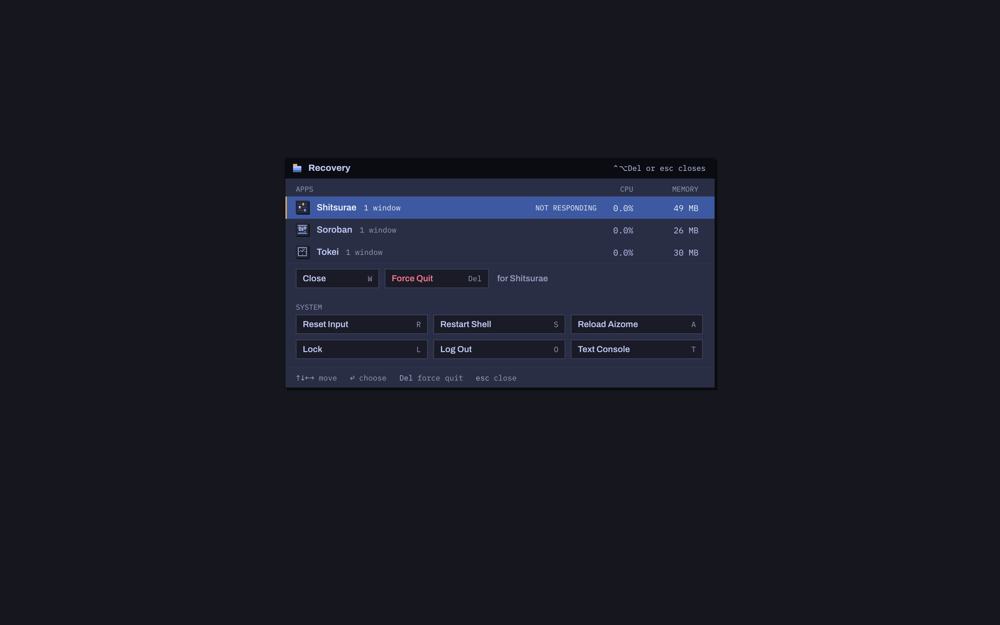

# Recovery

When an app hangs, runs away with the CPU or memory, or a full-screen
game holds the keyboard and pointer, **Ctrl+Alt+Del** opens Aizome's
recovery overlay: the running apps, how they're doing, and the few things
that get a stuck desktop going again. When the compositor itself stops,
systemd's watchdog restarts it and the next one says what happened. When
even that can't help, the kernel's SysRq keys are the last resort.

## The overlay

The compositor draws it itself (`crates/aizome-comp-core/src/recovery/`, with
the core's painter), so it works when the shell or an app is the
problem; it's part of the compositor's stable core, not the reloadable
logic, so it works when the logic has failed too (`docs/reload.md`).

- **Ctrl+Alt+Del** opens it from anywhere. It is checked before anything
  else looks at a key: key bindings, overlays, grabs (an app's menu, an
  input method), keyboard-shortcut inhibitors (games, VMs and remote
  desktops take every other chord) and the lock screen. Escape or
  Ctrl+Alt+Del again closes it.
- It shows above everything, full-screen clients and the lock screen
  included, on an opaque backdrop in the desktop's colour (nothing below
  is drawn, so it costs the same over a stuck game drawing every frame as
  over an empty Desk). Direct scanout is off while it shows (udev).
- While open it has the keyboard and the pointer: the app that had the
  keys hears `leave` (so it stops repeating a held key), pointer grabs end
  (a window being moved stops; a drag and drop is cancelled), menus close,
  a locked or confined pointer is free, and the cursor shows. Closing it
  gives them back; a game's persistent pointer lock comes back when the
  pointer is over it again.



### The list

One row per app ID (in the switcher's order, apps in trouble first): its
icon, name, window count, and

- **CPU**, percent of one core over the last second, and **memory**: an
  app with a systemd scope of its own (`app-aizome-<id>-<random>.scope`,
  as the shell and Hako launch apps) is measured as the whole scope
  (`cpu.stat`, `memory.current`), so Firefox's or Chromium's helper
  processes count; otherwise its process (`/proc/PID/stat`, `statm`).
  Read by a thread of its own (`procinfo.rs`), never by the compositor's
  main loop, since `/proc` can block on a stuck process.
- **Not responding**: the compositor pings every client with a window
  (`xdg_wm_base.ping`) every 2 s, every 0.5 s while the overlay shows; an
  app whose ping has waited 2.5 s is marked. **Crashed**: every process
  behind its windows is gone, a zombie, or dumping core, while its windows
  linger. **Stopped**: SIGSTOP or a debugger.

### Actions

| Action | Key | What it does |
|---|---|---|
| Close | W, or Return on a responding app's row | Asks each of the app's windows to close |
| Force Quit | Delete, or Return on a row in trouble | SIGKILL to the app's scope (`cgroup.kill`, all of it at once) when it has one named for it, else to its processes. If its windows are still there 1.5 s later (a process stuck in the kernel), its Wayland connection is cut so they go anyway |
| Reset Input | R | See below |
| Restart Shell | S | Restarts `aizome-shell` now (SIGKILL, then a start without backoff); apps keep running. Over the lock screen it is Restart Lock Screen, and the new shell is asked to lock again |
| Reload Aizome | A | `reload::reload_compositor`: reloads the compositor's logic in place from its saved state, keeping every window (the installed build, even if it's the one running: also the way back from a logic that was set aside); `docs/reload.md` |
| Lock | L | Asks the shell to lock |
| Log Out | O, twice | Ends the session (the second press within 4 s confirms) |
| Text Console | T, twice | Switches to a text console (2–6, not the session's own) through the session (libseat). The first press says which console and the way back, Ctrl+Alt+F and the session's console (F2 under GDM, which keeps its login screen on 1); the second, within 4 s, goes |

The arrows and Tab move between the rows and the actions, Return does the
focused one, and a click on a row selects it (a second click does its
default). The result of the last action shows under the title.

Force Quit never signals the compositor, its parent (the session or the
user's systemd) or init, and uses a cgroup only when it is a scope or
`app-*.service` under the user's manager **named for that app** and not
the compositor's own. A program started from a terminal lives in the
terminal's scope, so only its process is killed; programs the compositor
started itself (❖Return's terminal, `aizomectl spawn`) live in
`aizome.service`, so only their process is.

**X11 apps** come through xwayland-satellite, whose one Wayland connection
carries every X window. The process thread asks the X server which
clients own the top-level windows whose `WM_CLASS` is the app's ID
(X-Resource client IDs, else `_NET_WM_PID`) and measures and kills those.
Only if the X server can't say (in 0.5 s) is satellite's own process the
fallback, which stops every X11 app (and satellite restarts). Satellite's
connection is never cut for an app's lingering windows. Satellite answers
pings itself, so a hung X11 app isn't marked Not responding.

### Over the lock screen

Only Reset Input, Restart Lock Screen and Text Console are offered, no
app is listed (titles would show what's open), and Delete does nothing:
nothing that ends someone's work or shows it without the password.

### Reset Input

Lets go of whatever holds the pointer or the keyboard (`reset.rs`):

- every pointer and keyboard grab ends: moves, resizes and tab slides,
  menus (every popup is dismissed), the switcher, the overview, the
  marking menu and the area picker, a drag and drop (cancelled: the
  pointer leaves every surface first);
- buttons and keys the seat holds as pressed are released (clients hear
  the keys' releases), and sticky and slow keys start over;
- the pointer constraint of the surface under the pointer (or the one the
  overlay freed) is turned off, and stays off until that surface is
  clicked or asks for a new one, so a hung game can't lock the pointer
  again at once;
- the cursor shows (the client's own again once it sets one).

## Stuck pointers

A drag that wouldn't end was the reason this exists: a window dragged
around (Settings' Bluetooth pane, during discovery) stayed stuck to the
pointer after the button came up, and clicks went nowhere useful.

Smithay's seat ends a grab (a move, a resize, a client's implicit grab
while a button is held, a drag and drop) only once it holds no button at
all, and the compositor used to keep back the releases of buttons whose
presses the seat had seen whenever one of its overlays was up (the
switcher, the overview, the area picker, a sticky marking menu, which a
client's window-menu request opens while its button is still down). The
seat then held that button for ever: the next move's release didn't end
it, and the app that had the press kept the pointer. Now the compositor
tracks which presses reached the seat and always gives it their releases
(`Interactive::forwarded_buttons`), and its own grabs end when the button
that started them comes up, or is pressed again (its release went
missing), whatever else is held and whatever any client does
(`grabs::ends`). A client asking late to move its window (with the
serial of a press long released) starts nothing, as before.

Settings made it worse: showing the Bluetooth pane registered BlueZ's
pairing agent from its UI thread, a few synchronous round trips to
bluetoothd allowed two seconds each, and as many to unregister when the
pane hid. With bluetoothd busy (discovery, a device connecting) the
window stopped drawing and answering for seconds. Registration now runs
on the agent's own thread, in order (`aizome-sys::bluetooth::agent::Worker`).

`tests/recovery.rs` keeps both: `a_drag_ends_on_release_after_an_overlay_took_a_release`
(fails without the fix: the seat still held the right button and the tab
wouldn't drag), `a_frozen_apps_window_drags_and_lets_go` and
`a_late_move_request_starts_no_grab`; and aizome-sys's
`registering_the_agent_never_waits_for_bluez`.

## Stalls

If the compositor's main loop stops, nothing in it can draw or open the
overlay. So, from outside it (`watchdog.rs`):

- **systemd's watchdog.** `aizome.service` has `WatchdogSec=30s`; a timer
  on the main loop sends `WATCHDOG=1` every third of that. A loop stalled
  for 30 s is stopped by systemd with SIGABRT (`TimeoutAbortSec=5s`), so
  a core dump shows where it was (`coredumpctl info aizome`); with
  `KillMode=mixed` only the compositor gets it, and the rest of the
  service (the shell, xwayland-satellite, programs the compositor
  started) is killed after it.
  `aizome-session` sees the service's result is `watchdog` and starts it
  again, up to three times in a row (a run of five minutes resets the
  count); any other end of the compositor still ends the session. Apps
  lose their windows then, which can't be helped.
- **A stall watcher thread.** The loop beats on every iteration. After
  2 s without one the thread logs that the loop is stalled; at 18 s (60%
  of the watchdog's time) it captures the main thread's backtrace (a
  signal handler on that thread takes it; symbols resolve on the watcher
  thread), the kernel's `wchan` and `syscall` for it, logs them, and
  appends them to `~/.local/state/aizome/stall.log` with a marker beside
  it. If the loop comes back the marker goes ("recovered after …"); if
  the compositor was stopped instead, the next one opens the recovery
  overlay with "Aizome stopped responding at HH:MM and was restarted;
  apps that were open had to close" and where the details are.
- `aizomectl debug-stall SECONDS` blocks the main loop (at most 60 s), to
  try all this; the NixOS VM test does.

### Priority

Under load the compositor runs first, so it keeps drawing and Ctrl+Alt+Del
opens at once:

- `aizome.service`: `CPUWeight=1000`, `IOWeight=1000`, against the rest
  of `session.slice` (pipewire, the portals) at 100.
- The NixOS module raises `session.slice` to `CPUWeight=400` and
  `IOWeight=400` against `app.slice`'s 100. Raising the session rather
  than lowering apps keeps apps ahead of `background.slice` (30).
  Elsewhere, a drop-in does the same:
  `~/.config/systemd/user/session.slice.d/aizome.conf` with `[Slice]`,
  `CPUWeight=400`, `IOWeight=400`.
- No negative `Nice=`: a user manager without `CAP_SYS_NICE` (or a raised
  `RLIMIT_NICE`) fails to start a service that asks for one.

### Frame times

Release build, 2880 × 1800 at 2× (headless, ten windows behind), CPU per
frame: opening it **0.6 ms** under GLES and **2.1 ms** under pixman (the
first time too: its labels are rasterized at start and drawn once
offscreen, so their textures are on the GPU); the list updating each
second **≤ 0.8 ms** / **≤ 0.5 ms**; moving through it **≤ 1.9 ms** /
**≤ 2.8 ms**. Over a full-screen client drawing every frame nothing below
is redrawn (138 of 141 redraws found no damage). `examples/frame_bench.rs`
measures these.

## The last resort: SysRq

When the compositor is gone and the keyboard with it (stuck with the
pointer, or the kernel itself struggling), the kernel's magic SysRq keys
still work, held as **Alt+SysRq** (Alt+Print) and a letter:

- **R** takes the keyboard back from the compositor (raw mode off), so
  **Ctrl+Alt+F3** then reaches a text console to log in and look (not
  F2, which under GDM is the session itself);
- **F** runs the OOM killer once: the biggest memory hog dies (the
  usual cure for a machine thrashing);
- **E**, **I**: SIGTERM, then SIGKILL, to every process but init;
- **S**, **U**, **B**: sync the disks, remount them read-only, reboot
  (the end of "R-E-I-S-U-B", a few seconds apart).

NixOS allows only S (sync) by default (`kernel.sysrq = 16`). To allow the
ones above:

```nix
boot.kernel.sysctl."kernel.sysrq" = 244; # R, K, E, I, F, S, U, B (4+16+32+64+128)
```

(`1` allows all of them.) Aizome's module leaves it as the system has it.

## IPC and testing

- `aizomectl recovery [on|off]`, `recovery status`, `recovery force-quit
  APP_ID`, `recovery close APP_ID`, `recovery reset-input` and the other
  actions; `aizomectl input-state` shows the pointer grab, the buttons
  and keys the seat holds, the pointer constraint and the cursor
  (`docs/ipc.md`).
- `crates/aizome-comp/tests/recovery.rs`: Ctrl+Alt+Del over a full-screen
  client holding a keyboard-shortcuts inhibitor (and its keys going to the
  overlay, then back), a held key let go, Force Quit killing a client in a
  process of its own (and refusing the compositor's parent), a frozen app
  marked Not responding, only safe actions over the lock screen, Reset
  Input ending a stuck grab and freeing a locked pointer, and the drag
  regressions above.
- `nix/vm-test.nix`: a full-screen foot force-quit with Ctrl+Alt+Del and
  Delete through `aizomectl input`, and a stalled compositor restarted by
  the watchdog, with its stall log and the notice.
