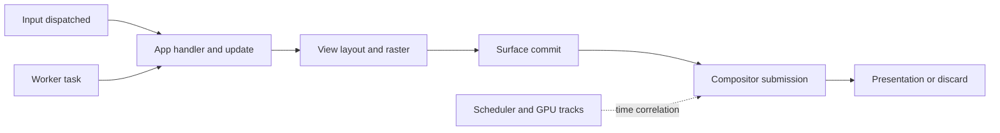

# On-demand profiling for Aizome

Research and workstation experiments, 27 October 2026. Baseline:
`4dc885718ce48fd5555adff48908ab517efb62fe` (main), branch
`research/on-demand-profiling`. This is a design investigation, not a shipped
profiling feature. No desktop defaults, kernel policy or release workflows
were changed.

## Recommendation

Build two complementary capabilities: **matching symbols and selected-app
sampling first; a bounded interaction timeline second**. Give both a common
recording controller in Myaku and Settei. Use Perfetto as the timeline format
and analysis tool. Keep Tracy as an explicit developer capture backend and
Superluminal as an optional sampling viewer/recorder.

The largest missing capability is causality: which work belongs to an input,
which buffer contains its result, and when that buffer actually appeared.
More frequent CPU samples cannot supply this relationship. Conversely,
instrumented spans cannot alone explain a long descheduling gap or identify
an expensive function inside an uninstrumented third-party app.

Prefer shipping dormant, coarse instrumentation in the normal optimized
build. Users should be able to record a native app already running. Keep
expensive allocation, GPU and detailed function capture as separate modes.
Do not rebuild the entire distribution with frame pointers or install a
continuous profiler to obtain the first useful result.

## EV-ranked menu

EV here means expected recurring diagnostic benefit, weighted by likelihood
of usable coverage, relative to engineering effort, ongoing maintenance and
the idle/capture cost. These are ordinal judgments, not measured numerical
utilities. Effort is relative: S = a focused package/tool integration,
M = several components, L = a substantial cross-process feature, XL = a
platform commitment. The options are complementary; prerequisites are noted.

| Rank | Option and posture | Expected value | Effort / confidence | Principal limitation |
| --- | --- | --- | --- | --- |
| 1 | Exact-build split symbols + Myaku-selected sampling; **conservative** | Highest near-term value across native and third-party code; no recorder needed while off | M, high for symbols; medium for app capture integration | CPU samples need scheduler data to explain waits; no automatic interaction causality |
| 2 | Native interaction/frame timeline exported to Perfetto; **balanced** | Highest strategic value for this request: distinguish app work, scheduling, compositor and presentation | L, medium; depends on a capture controller, not on symbols for named spans | Requires explicit correlation in Kit/Sidestep/compositor; stock third-party internals remain partial |
| 3 | Scripted interaction benchmarks and trace comparisons; **conservative**, game-development inspired | Compounds every fix: detect regressions, reproduce hitches, compare percentile distributions | M, high; builds on existing harnesses and later option 2 | Lab results do not replace the user's reproduction or battery hardware |
| 4 | Chrome and toolkit capture adapters; **balanced** | Rich third-party semantics without maintaining forks of every application | M–L, medium; shares option 2's clock/session metadata | Different tools, launch requirements and support per application; no universal Qt adapter |
| 5 | Steam/GPU escalation kit; **conservative entry, aggressive deep mode** | Good limited-cost game coverage using frame pacing and driver timelines | S–M for pacing, L for deep GPU; medium/low respectively | Relaunch often required, GPU/vendor/runtime dependent; game-engine intent usually unavailable |
| 6 | Tracy frame-analysis mode for Aizome developers; **aggressive** | Excellent CPU zones, worker/lock relationships and instrumented GPU frame investigation | M, medium; match the packaged client/server versions | On-demand alone is not dormant; cross-process desktop analysis is less natural |
| 7 | User-armed rolling hitch recorder; **aggressive** | Captures the seconds before a sporadic hitch, when manual recording is too late | M after option 2, medium | Bounded memory still costs memory and work while armed; cannot recover uncaptured history |
| 8 | Targeted scheduler/USDT/uprobe/eBPF diagnostics; **aggressive** | Explains off-CPU stalls, I/O and some opaque application boundaries | M–L, medium for kernel events, low for arbitrary app probes | Privileges, kernel/version differences and high event rates; probes do not infer semantics |
| 9 | Distribution-wide unwindability + shared interaction tracing contract; **radical** | Potentially excellent ecosystem coverage if widely adopted | XL, low near-term | Persistent compiler tax, cache rebuilds, proprietary binaries and upstream adoption |

Implement 1 and a narrow version of 2 together: one native app, the shell and
the compositor, with a simple start/stop/save flow. Add 3 to keep the feature
honest. Pursue Chrome integration before generic third-party instrumentation.
Option 5 can have an early, deliberately limited release independent of the
full timeline. Options 6–9 should not delay the first useful capture.

## What exists in this tree

The baseline has useful measurements but no common timestamped trace:

| Existing code | What it establishes | What a trace must add |
| --- | --- | --- |
| [Compositor FrameStats](../desktop/aizome/crates/aizome-comp-core/src/stats.rs) | Last 4,096 CPU and optional GPU durations per output, rendered/skipped counters; percentiles on request | Frame/commit identity, absolute timestamp, output deadline and source process |
| [Kit statistics](../desktop/aizome/crates/aizome-kit/src/stats.rs), [engine](../desktop/aizome/crates/aizome-kit/src/engine.rs), [app](../desktop/aizome/crates/aizome-kit/src/app.rs) | Last 1,024 event/update/view-layout/paint samples and damage measurements | The relationship between phases, frames, async tasks and inputs |
| [Settei Performance](../desktop/aizome/apps/settei/src/panes/performance.rs) | Compositor summaries and this Settings window's own view/paint statistics | Session controls and links to the selected capture |
| [Myaku sampler](../desktop/aizome/apps/myaku/src/sampler.rs), [grouping](../desktop/aizome/apps/myaku/src/group.rs) | Process/app identity, CPU, memory, DRM usage, energy attribution; default one-second sampling with costly reads less often | Capture target discovery; do not increase its ordinary polling to tracing rates |
| [DRM backend](../desktop/aizome/crates/aizome-comp-core/src/backend/udev.rs) | Real presentation feedback from DRM timestamps and sequence numbers | Export those records and connect them to the submitted surface commits |
| [Generic backend](../desktop/aizome/crates/aizome-comp-core/src/backend/mod.rs) | Optional GPU fence **wait duration**, and synthetic/headless presentation | Explicit timestamp provenance; fence wait is not GPU execution duration |

The production DRM render path currently constructs `Frame` with `gpu: None`.
Its CPU value is elapsed time around collecting/rendering/queueing, not measured
thread CPU time. It can contain descheduling. A headless benchmark's presentation
feedback is not a display scanout measurement. None of these is input-to-photon
latency; scanout position and panel response require separate hardware evidence.

Myaku's app grouping is a valuable starting point for selecting Chrome's
renderer/GPU/helper processes. It must not become an authorization boundary:
window identities are hints, process identity needs UID plus PID/start time
and preferably a pidfd, and shared session scopes are not an application.

### Recover the earlier symbol work selectively

The prior work is present at `f88ac0e` and `4810fc4`, migrated to Sekka at
`4ed1d36180634a016ede835128b6cc706d4d8f72` on `codex/migrate-aizome-22`.
It is **not in this main baseline**. Its
`desktop/aizome/docs/profiling.md`, `scripts/aizome-profile` and package changes
already explain Heaptrack, matching symbols and source paths. That branch also
contains unrelated memory experiments and implementation changes; recover the
profiling pieces separately rather than merge its whole scope by accident.

Root-flake evaluation confirmed that today's Aizome package has only an `out`
output. Its release profiles already request `line-tables-only` and use no LTO
for the compositor's Rust dylibs, thin LTO for other apps. The draft preserves
DWARF before Nix stripping and exposes a separate debug output; it also handles
the Nix hook's injected Rust `-g` flags and Cargo's hyphenated profile settings.

## Workstation experiments

All compilation and execution below ran through `ssh wx-workstation`, in
`/home/callen/work/sekka-profiling-research-20261027`. The laptop was used for
source inspection, edits and transferring files. Hardware: Threadripper PRO
9985WX, 128 logical CPUs, approximately 250 GiB RAM; Ubuntu kernel
`6.17.0-1032-oem`, performance governor. Other builds were active. There was
roughly 76–84 GiB free; no full desktop or image build was attempted.

These are focused synthetic/library experiments, not Aizome workload,
physical-display or battery validation. The workstation has no relevant laptop
discharge measurement. An eight-second interval with zero CPU ticks means less
than the tick measurement can resolve, not mathematically zero CPU cost.

### 1. Split symbols: both ELF mechanics and the pinned Nix hook passed

The Rust fixture was built optimized, with line tables. Extracting its debug
data preserved the build ID, byte-identical `.text`, byte-identical `.eh_frame`
and the program's result. `addr2line` on the detached debug file resolved
`interaction_stage` to `probe.rs:5`. The standalone runtime went from 3,957,776
to 435,152 bytes after removing debug sections; the detached file was
3,609,992 bytes. These are **toy binary sizes**, not projected Aizome savings.

A separate derivation using Sekka's root-flake-pinned Nixpkgs passed the same
code/unwind checks, resolved the source line through the `.build-id` debug
file, ran the stripped executable, and confirmed the runtime closure does not
include the debug output. This supports the packaging technique; it does not
validate a rebuilt complete Aizome package or its reload ABI.

Evidence: [raw fixture results](experiments/profiling/workstation-results.json),
[Nix results](experiments/profiling/nix-symbol-results.json),
[Nix fixture](experiments/profiling/nix-symbols.nix).

### 2. Tracy 0.14.1: on-demand is not the same as dormant

Built the upstream version matching Sekka's Tracy pin, with broadcast disabled
and localhost binding. After two seconds of settling, observed eight seconds
of idle, without a profiler connection:

| Configuration | Threads | PSS KiB at start | Additional context switches, all threads |
| --- | ---: | ---: | ---: |
| Instrumentation compiled out | 1 | 957 | 0 |
| On-demand | 4 | 2,664 | 1,594 |
| On-demand, system tracing/sampling compiled out | 4 | 2,484 | 1,593 |
| Manual lifetime, never started, guarded trace sites | 1 | 2,054 | 0 |
| Manual lifetime, after two startup/shutdown cycles | 1 | 3,485 | 0 |

The last row is a separate lifecycle probe and did not connect a server.
Manual shutdown recovered the idle thread behavior but not all resident
memory. Context switches are not a direct energy or hardware-wakeup measurement.
The on-demand results are sufficient reason to reject that configuration as
an assumed battery-neutral default across every native app.

A 10-million-iteration synthetic zone loop, interleaved across configurations,
had medians of 0.86 ns compiled out, 1.92 ns on-demand, 1.89 ns without system
tracing and 1.63 ns with the manual-start guard. These tiny-loop numbers exclude
startup, run on a shared machine and say nothing reliable about capture-active
desktop frame overhead. Their useful lesson is that cheap disabled trace sites
can coexist with nontrivial background client behavior.

Evidence: [probe source](experiments/profiling/tracy-probe.cpp),
[initial results](experiments/profiling/workstation-results.json),
[teardown results](experiments/profiling/tracy-teardown.json).

### 3. Perfetto v56.1: bounded capture and re-arming passed

Used the upstream C++ SDK, a single 512 KiB trace buffer and an explicitly
selected category. Two captures in the same process each emitted 1,000
synthetic spans; Trace Processor found exactly 1,000 in each file. Neither
contained the span emitted between sessions. The trace files were 41,419 and
41,398 bytes. This tests session lifecycle and import, not multiprocess flows.

| State | Threads | PSS KiB at start | Additional context switches over eight seconds |
| --- | ---: | ---: | ---: |
| Linked, SDK not initialized | 1 | 1,313 | 0 |
| Initialized, never recording | 2 | 2,824 | 0 |
| Two captures finished | 2 | 3,727 | 3 |

This is materially quieter in this experiment than Tracy's disconnected
client, but it retains a worker and memory. The in-process backend does not
establish the idle behavior of the system backend, the Rust SDK, or dozens of
apps. Lazy startup and a bounded number of participating processes still matter.

Evidence: [source](experiments/profiling/perfetto-probe.cpp),
[results and trace hashes](experiments/profiling/perfetto-results.json).

### 4. Sampling preflight: blocked by workstation policy

The default `/usr/bin/perf` wrapper cannot find tools matching this OEM kernel.
The installed `7.0.0-38-generic/perf` executable runs but rejects even a
99 Hz `cpu-clock:u` recording of its own `sleep` child under
`perf_event_paranoid=4`. No sampling capture was obtained; no sampling overhead,
unwind quality or Superluminal capture is claimed. Noninteractive sudo is not
available, and no kernel settings or privilege policy were changed.

This is useful product evidence: the UI needs capability preflight and an
explanation of what can be captured before starting. A missing permission or
unwinder must not produce an apparently valid but empty or misleading profile.

## Option details and tradeoffs

### 1. Symbols plus sampling

Ship a debug output from the **same optimized derivation** as each runtime,
including core and reloadable logic libraries. Maintain a build-ID-to-output
index alongside the existing cache when publication is separately authorized.
Fetch symbols only when a capture needs them, ideally after recording. Start
with selected first-party artifacts; broaden third-party symbols according to
actual package support. Preserve exact source mappings and flag missing symbols.

Post-link split files are different from Rust's compiler `split-debuginfo`
settings (`.dwo`/`.dwp`) and from frame pointers. Detached DWARF improves source
resolution and optional distribution; it is not a live-heap optimization, nor
does it make an unwinder traverse otherwise un-unwindable code. Keep unwind
tables and compositor panic recovery. [GDB's separate-file mechanism](https://sourceware.org/gdb/current/onlinedocs/gdb.html/Separate-Debug-Files.html)
and [Nixpkgs separateDebugInfo](https://nixos.org/manual/nixpkgs/stable/#var-stdenv-separateDebugInfo)
support this separation.

Use `perf` as an interoperable capture base, with Samply/Firefox Profiler or
[Hotspot](https://github.com/KDAB/hotspot) as analysis choices; test supported
import and symbol discovery for the pinned tool before choosing the default.
[Samply](https://github.com/mstange/samply)
is an active Linux sampling option. A proposed low-cost preset is 99 Hz,
selected application processes, 10–30 seconds, bounded output. Increase rate
only for a specific investigation. A roughly 10 ms sampling interval can miss
the entirety of a 4 ms interaction.

Compare DWARF stack copying/unwinding with frame-pointer sampling, but do not
silently force frame pointers in the normal package. At 99 samples/s, an
8 KiB stack dump alone is about 0.77 MiB/s per continuously sampled CPU stream,
before metadata or compression. Frame pointers can reduce recording work but
need coverage through libraries, not just the top executable. LBR/IBS/other
hardware-assisted methods merit specialist presets, not a portable default.

Superluminal deserves a real trial on Sekka: it is already packaged, and its
Linux page describes an eBPF unwinder that handles missing frame pointers.
The pinned package is the older `1.0.7705.679-alpha`; current vendor material
calls Linux beta. The vendor lists the Linux instrumentation API as missing,
32-bit support untested and Qt Wayland support absent. Therefore use it as an
optional sampling/scheduling experience, not the common native annotation
backend. Actual pinned-version symbol lookup, overhead and authorization need
testing; Windows documentation is not evidence of Linux feature parity.
[Vendor Linux status](https://superluminal.eu/applications/linux/).

### 2. Native timeline with a small dormant event interface

Instrument a small fixed vocabulary: input dispatched, application handler,
update, view/layout, raster work, buffer ready/commit, compositor wake/collect,
render submission and actual presentation/discard. Add async task enqueue,
worker start/end and result receipt only where they explain a real delay.
Keep counters for damage, queue depth and missed deadlines alongside spans.
Retain the input event's original timestamp and clock provenance separately
from dispatch time to expose time spent waiting before dispatch; neither is
automatically the physical switch/sensor actuation time.

Use the existing Kit phase boundaries and compositor hooks. Sidestep's raster,
buffer and Wayland event handling needs matching instrumentation through its
pinned source. Expose session control over Aizome IPC; do not poll every app
at frame rate. Own the compositor's recorder in the stable core. Do not start
a separate tracing runtime in each reloadable logic library. Retain build IDs,
load/unload ranges and logic generation in the trace so reloaded code resolves
against the library actually executing.

Two transport candidates deserve an integrated A/B trial:

* Direct Perfetto SDK producers: mature track/event semantics and system
  tracing integration, but per-process lifecycle and memory cost. The
  [Rust SDK](https://perfetto.dev/docs/getting-started/rust-sdk) is community
  maintained; its FFI, feature parity and idle behavior require a separate test.
* A small backend-neutral Rust event interface with a lazily allocated,
  bounded queue, drained by a session recorder which exports Perfetto. This
  can keep disabled applications free of SDK worker threads and put encoding,
  symbolization and I/O outside the compositor. It introduces queue ownership,
  loss reporting and lifecycle work. It is a proposed design, not a tested
  implementation in this branch.

Prefer the small interface if the SDK cannot meet the idle/teardown budget.
Use static event names and gate timestamps/arguments before computing them.
Never block a producer on a full queue: count drops and continue rendering.
Export batches, and run analysis after capture, optionally on the workstation.
The [Perfetto SDK](https://perfetto.dev/docs/instrumentation/tracing-sdk) and
[track-event model](https://perfetto.dev/docs/instrumentation/track-events)
provide categories, tracks and flows; format choice does not require every
application to embed its full SDK.

The existing Rust `tracing` subscriber can host a backend, but simply adding a
reloadable layer is not evidence of a lock-free hot path. Its
[reload implementation](https://docs.rs/tracing-subscriber/latest/src/tracing_subscriber/reload.rs.html)
uses an RwLock. Filter changes must also refresh
[cached callsite interest](https://docs.rs/tracing/latest/tracing/subscriber/trait.Subscriber.html).
Measure the actual disabled call sites, not only the recorder's idle process.

### 3. Performance scenarios and regression history

Borrow the game-development practice of named scenes and frames. Reuse the
Kit harness and `frame_bench.rs`; add stable scenarios for palette opening,
Sumi typing/scrolling, window dragging, Desk transitions, Chrome scrolling and
Telegram chat scrolling. Save scenario data, revision, build IDs, renderer,
output scale/refresh/VRR, power mode and driver versions with every result.

Separate cold startup/first-use from warm repeated runs. Interleave baseline
and candidate on one machine, replay the same input sequence, and compare
p50/p95/p99, missed frame deadlines, longest hitch clusters, CPU time, PSS and
idle activity. Save the trace around a regression for inspection. Use the
workstation for builds, software-renderer correctness and repeatable workloads;
use representative physical graphics and laptop power tests for conclusions
about those devices. Build noise invalidates small timing differences.

### 4. Third-party app adapters

| Target | Useful initial coverage | What needs additional cooperation |
| --- | --- | --- |
| Aizome-native | Kit + Sidestep + compositor spans, exact symbols | Async flow propagation and commit/input mapping |
| Google Chrome / Chromium / Electron | Native sampling plus browser trace tracks for input, browser/renderer work, rendering and JavaScript where enabled | Browser-specific capture setup, process mapping and verified clock alignment; V8 JIT identities are not supplied by ELF DWARF |
| Telegram Desktop | Selected process/thread sampling, scheduler context, compositor-visible commits/presentation | Internal event/paint zones require matching symbols and an instrumented build or targeted probes; QML Profiler is not a universal Qt Widgets profiler |
| GTK 4 apps | Toolkit frame-clock/render tracks through Sysprof when built with support | Usually launching under the capture wrapper, format integration and app-specific work |
| Steam games | Frame pacing, CPU sampling, driver/kernel events when supported | Engine markers/symbols generally unavailable in retail games; Proton/JIT/32-bit boundaries need separate validation |

Chrome already has extensive trace instrumentation. Its documented desktop
capture path uses Perfetto's UI and a Chrome extension, or automation through
Crossbench. Treat that as an adapter, not proof that stock desktop Chrome will
automatically join Aizome's system tracing session. Collect process identity,
clock metadata and overlap; only merge when synchronization is verified.
Avoid enabling a browser debugging endpoint in an ordinary user's session as
an invisible side effect. [Chrome capture documentation](https://perfetto.dev/docs/getting-started/chrome-tracing).

GTK exports frame-clock/GSK timing to Sysprof through `SYSPROF_TRACE_FD`.
Qt Creator's performance analyzer consumes perf samples; its QML profiler
requires the QML debugging infrastructure. Telegram has its own rendering
paths, so a Qt label alone does not imply QML coverage.
[GTK profiling](https://docs.gtk.org/gtk4/running.html#profiling),
[Qt native analyzer](https://doc.qt.io/qtcreator/creator-cpu-usage-analyzer.html),
[QML requirements](https://doc.qt.io/qt-6/qtquick-profiling.html),
[Telegram source](https://github.com/telegramdesktop/tdesktop/blob/dev/Telegram/SourceFiles/mainwidget.cpp).

Heaptrack remains useful for a separate allocation investigation, especially
given the prior branch's wrapper. Allocator interception and stack collection
distort timing; relaunching is usually easier to reason about than injection
into a running desktop. Count PSS, shared buffers and GPU allocations separately:
an allocator trace is not total process memory. [Heaptrack](https://github.com/KDE/heaptrack).

### 5. Steam and graphics: useful without promising an engine profiler

Start with a per-game preset using MangoHud frame-time logging, short captures
and a repeatable game benchmark/replay. Its visibility toggle and logging toggle
are distinct: hiding the overlay does not remove instrumentation. Installation
or launch-option changes may require restarting the game. Use the documented
`mangoapp` integration when Gamescope is the enclosing compositor. Keep results
local by default. [MangoHud](https://github.com/flightlessmango/MangoHud).

Next correlate scheduling and DRM/driver events with frame pacing. GPUVis is
specifically oriented toward Linux GPU/scheduling timelines; its trace-cmd
workflow supports a rolling capture. Mesa's Perfetto producers offer richer
integration, but require a suitable Mesa build and driver support; the current
documented matrix is not universal, including across Intel/AMD/NVIDIA.
[GPUVis capture](https://github.com/mikesart/gpuvis/wiki/trace-cmd),
[Mesa support matrix](https://docs.mesa3d.org/perfetto.html).

Escalate a confirmed GPU problem to RenderDoc, NVIDIA Nsight Graphics or AMD's
Radeon tools as appropriate. Nsight GPU Trace has hardware requirements;
graphics replay is a different workload from the live application. These are
specialist experiments, not evidence of low-overhead default desktop tracing.
Do not inject layers indiscriminately into anti-cheat/protected games. Present
an unavailable adapter as unavailable and retain external timing coverage.
[Nsight GPU Trace](https://docs.nvidia.com/nsight-graphics/UserGuide/gpu-trace-overview.html),
[replay distinction](https://docs.nvidia.com/nsight-graphics/UserGuide/graphics-capture-ui.html).

### 6. Tracy as the frame laboratory

Tracy fits the game-developer view well: named frames, nested CPU zones, worker
threads, locks, GPU zones and frame comparisons. Add coarse zones before
instrumenting every function; detailed zones and allocation hooks can dominate
small UI operations. Use manual lifetime, explicit activation, localhost-only
connections and no broadcast. Compile system tracing, stack sampling, allocator
events and crash interception only into modes that need them. Do not compete
with the compositor's recovery handling by default.

The client must match Sekka's pinned 0.14.1 server, including the version
bundled by any Rust binding. The standalone C++ measurements do not certify
`tracing-tracy`, reloadable Rust dylibs, GPU zones or connected-capture teardown.
Validate all of those before enabling this in the standard build. A development
package with restart-required activation is a reasonable first step for Tracy,
while the smaller native timeline remains the normal on-the-fly feature.
[Pinned Tracy manual](https://github.com/wolfpld/tracy/blob/v0.14.1/manual/tracy.tex),
[Rust client controls](https://docs.rs/tracy-client/latest/tracy_client/).

### 7. An explicitly armed hitch recorder

Offer “Watch for a hitch” for a selected app or interaction: keep a fixed-size
in-memory ring, retain a few seconds before the trigger, stop after a short
post-trigger interval, then save off the rendering thread. Use actual output
deadline misses and long phase durations as triggers, with hysteresis and a
cooldown. Give the user a bookmark shortcut to mark a felt hitch.

This follows Unreal Insights' channels, bookmarks, snapshots and tail buffers.
Screenshots are optional and expensive; they should not be necessary for the
first version. The recorder is armed only by the user and expires. Its ring
cannot reveal the period before it was armed; ordinary percentiles cannot be
turned into that history later. [Unreal trace controls](https://dev.epicgames.com/documentation/unreal-engine/using-the-trace-control-tab-in-unreal-insights-for-unreal-engine?lang=en-US).

### 8. Kernel and dynamic instrumentation

Start with selected scheduler wake/switch events, CPU frequency and relevant
I/O/fault events to distinguish running, runnable and blocked time. Add specific
uprobes/USDT only for a known unanswered question. Tracepoint stability differs
from probing private app functions; optimization, inlining and version updates
can invalidate the latter. Blanket syscall tracing or a stack on every
scheduler event is a poor default on a busy, many-core machine.

Alternatives to the proposed native transport include Linux `user_events`
(kernel-updated enable bits; writes when enabled), USDT probes, and LTTng-UST's
typed events/session controls. They provide established collection paths but
introduce kernel/permission or CTF/conversion integration and do not supply
cross-app causality automatically. Do not maintain all of them initially.
[user_events](https://docs.kernel.org/trace/user_events.html),
[LTTng probe/event controls](https://lttng.org/man/1/lttng-enable-event/v2.14/).

OpenTelemetry's eBPF profiler is a serious alternative for unwinding native
and mixed-language stacks without rebuilding apps. Its stated testing ceiling
of 1% CPU/250 MB is a datacenter-oriented envelope, not a laptop budget or
measured Sekka result. Explore it as a bounded expert session, not a persistent
desktop agent. [Upstream implementation](https://github.com/open-telemetry/opentelemetry-ebpf-profiler).

### 9. Radical platform changes

One route is a profiling-friendly distribution: frame pointers in first-party
and dependency packages, retained symbols for every release, and a shared
toolkit/Wayland/IPC interaction contract. Another is an Aizome diagnostic image
with richer Mesa, kernel and app instrumentation. Both can produce excellent
research environments, but rebuilding changes what is being measured, and
neither reaches proprietary binaries or arbitrary game engines automatically.

Before adopting either, compare unwind coverage and real application
throughput/energy on x86_64 and aarch64. Measure text size, instruction/cache
effects and ongoing build/cache cost. A separate profiling image is useful as
a lab tool, but cannot satisfy “record the issue in my running desktop” alone.

## The interaction contract matters more than the viewer

Proposed trace path for a cooperative native app:

Every record needs a session ID, process identity, thread/track, category,
timestamp/clock domain and relevant window/surface/commit/output identifiers.
Use trace-local opaque identities. Native input and async work should carry
explicit flow IDs; represent many-inputs-to-one-frame and one-input-to-many-
frames rather than inventing a one-to-one mapping. Keep superseded/discarded
commits and dropped-event counters. A Wayland input serial by itself is not a
universal rendering transaction identifier.

Use a defined monotonic clock and explicit mappings for DRM/GPU/browser clocks,
including suspend behavior. Rust `Instant` values from separate processes do
not constitute a serialized shared clock specification. Perfetto can represent
clock snapshots; merge only when the mapping is known, with uncertainty if
estimated. [Clock synchronization](https://perfetto.dev/docs/concepts/clock-sync).

For unmodified apps, show observed input delivery and subsequent surface
activity with an explicit “correlated, causality unknown” label. An unrelated
animation might be the next commit. For XWayland or Gamescope, record the extra
boundary: the outer surface may represent several internal windows/game frames.
For a hardware presentation timestamp, label its hardware/completion flags;
fallback timestamps must not masquerade as measured physical presentation.

## Proposed user experience and operating budgets

In Myaku, select an application and choose **Record performance**. In Settei,
offer the same controller scoped to **Desktop and shell**. Presets:
**Timeline**, **CPU samples**, **Watch for a hitch**, with allocation/GPU
details under advanced options. Show what each app supports, whether it needs
a restart, and whether symbols or permission are missing. Offer 10/30/60 seconds,
Stop, a bookmark shortcut and a local saved-capture list. Opening the full
viewer after capture reduces observer load while reproducing the problem.

Suggested acceptance targets, to negotiate against actual measured noise:

| State | Target, not a current guarantee |
| --- | --- |
| Disabled | No profiling timer/network traffic/polling; no active recorder; no timestamp, allocation or formatting at disabled sites; target <1 MiB added PSS per process |
| First activation and teardown | UI/main loop never waits for symbol loading or disk; release bounded queues promptly; report any persistent SDK footprint; no orphan collector after UI/app exit or logout |
| Basic timeline | Start with a 64 MiB **aggregate** capture-memory target and a 256 MiB file ceiling, shared among participants; stop on duration/size limits; no blocking producer writes |
| Active overhead | Target <1% added selected-workload CPU and <0.1 ms added p95 phase duration for coarse native tracing; investigate p99/deadline regressions even if averages pass |
| Idle energy | Repeated laptop tests should show no persistent regression above a practical 1% target and measurement uncertainty, both before first capture and after stop |

The tested SDK footprints do not already satisfy every target. In particular,
retained memory after activation needs an integrated decision: a smaller
transport, explicit bounded retention, or an expert mode with a different
budget. Count per-thread/per-CPU kernel buffers, exporter queues and profiler
memory in the session budget; a nominal 64 MiB trace buffer alone is not a
64 MiB total cap. At high loss, show that the result is incomplete.

Use an unprivileged controller and a narrow authorized helper only when
sampling/kernel tracing requires it. Prefer a bounded `CAP_PERFMON` operation
over giving the GUI general root execution or globally lowering
`perf_event_paranoid`. CAP_PERFMON is powerful: the helper must still enforce
the requested UID/process scope and limits, rather than expose arbitrary perf
arguments. Some ftrace/eBPF paths need additional privileges. Sekka sets
`kptr_restrict=2`; kernel-symbol availability is a separate issue and must not
be silently “fixed” by weakening that policy. [Kernel perf security](https://docs.kernel.org/admin-guide/perf-security.html).

Tracing should record event classes and opaque tokens, not typed characters,
message bodies, window titles or URLs by default. Raw stack captures can also
contain sensitive bytes. Save with private permissions, make export explicit,
and stop/revoke collection at lock/logout or session expiry. This is part of
the feature's capture design, not a reason to collect fewer diagnostic phase
identifiers. Never profile the greeter/password path as an ordinary user preset.

## Implementation sequence and evidence needed

1. Recover only the matching-symbol packaging from the earlier branch. Build
   Aizome through the root flake on the workstation. Verify stripped runtime
   closures, symbol lookup in the selected profilers, source mappings and
   reload ABI; include both core and logic build IDs.
2. Implement a session controller and one-app sampling path. Exercise missing
   permissions, PID reuse/exit, worker processes, stop/cancel, missing symbols,
   full storage and recording limits. Keep normal Myaku polling unchanged.
3. Instrument one native app plus compositor/DRM with the small common event
   interface. Prove input-to-commit relationships, surface-to-presentation
   matching, clock mapping, async work and dropped events. A useful first
   reproduction is Sumi typing/scrolling or palette open, not every native app.
4. A/B direct SDK and external export, including ten capture cycles, normal
   exit, collector crash, compositor logic reload, multimonitor/VRR and lock.
   Benchmark disabled, active and post-stop states against the same optimized
   baseline. Avoid GPU fence waits in the ordinary measuring path; use
   asynchronous timer queries/calibration where supported.
5. Add Chrome capture with a verified shared time base, then toolkit-specific
   adapters. Add optional MangoHud/GPUVis workflows independently. Preserve
   honest “unknown” coverage for opaque third-party phases.
6. Run representative laptop idle/discharge and interaction tests, with stable
   display brightness, refresh rate, power mode, temperature and workload;
   use repeated interleaved trials, not CPU utilization as an energy proxy.
   Test integrated/discrete GPUs and aarch64 separately. No ISO qualification
   is implied by these component checks; an eventual installable image still
   follows the repository's ISO qualification process.

The present experiments establish viable building blocks and expose a concrete
Tracy idle-cost problem. They do not yet establish production capture overhead,
whole-stack clock/cause matching, Chrome/Telegram/game integration, or battery
neutrality. Those uncertainties drive the ranking and the order above.
