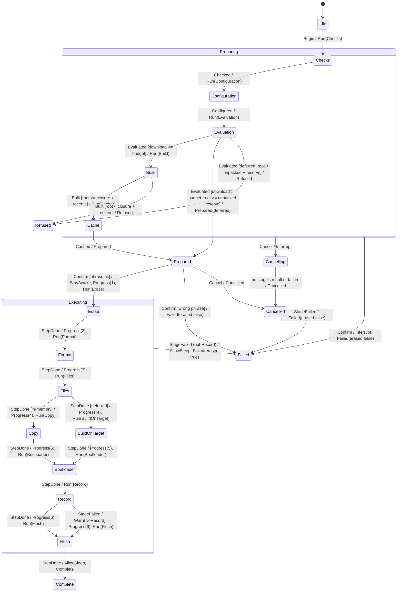

# `install`: preparation, confirmation, destructive steps

Catalog: **GEN-07** (install transaction) and **GEN-06** (privileged helper
session). Source at `8e0acbe5`: `installer/genkan/rust/src/install.rs`
(`Prepared` 267–285, `prepare` 325–524: checks 330–363, configuration
366–385, evaluation 387–420, the route choice 425–432, build 444–470, the
root-space guard 471–488 that runs **only** on the in-memory route, cache
490–504; `execute` 646–841: the configuration check 653–656, storage 671–679
(wipefs at 555, parted 559, mkfs from 579), files 681–706, copy or
deferred build 708–783, bootloader 785–803, record 806–824, flush 826–831,
`progress(6)` twice at 827 and 833), `helper.rs` (`session` 24–60: the
stdin reader that latches `CANCEL` 35–41, an early confirmation consumed
when preparation ends 53–59), `plan.rs` (`InstallPlan::confirm` →
`ConfirmedInstall`, 354).

A linear transaction driven by stage results: every stage is a `Run`
effect, and its result is an event. Sizes are MiB.

## Types

- `Config { reserve_mib: 8 GiB }`.
- `Stage`: `Checks`, `Configuration`, `Evaluation`, `Build`, `Cache` (the
  preparation), `Erase` (1), `Format` (2), `Files` (3), `Copy` or
  `BuildOnTarget` (4), `Bootloader` (5), `Record`, `Flush` (6).
- Events: `Begin`, `Checked { root_mib }`, `Configured`, `Evaluated {
  download_mib, unpacked_mib, budget_mib }`, `Built { closure_mib }`,
  `Cached`, `StepDone`, `StageFailed`, `Confirm { phrase_ok }`, `Cancel`.
- Effects: `Run(stage)`, `Prepared { deferred, closure_mib }`,
  `Progress(n)`, `StayAwake`, `AllowSleep`, `Interrupt`, `Refused {
  needed_mib, root_mib }`, `Warn(NoRecord)`, `Failed { erased }`,
  `Cancelled`, `Complete`.

**Input domain:** any event in any state.

## States and data

| State | Data |
|---|---|
| `Configuration`, `Evaluation`, `Build` | `root_mib` |
| `Cache` | `root_mib`, `closure_mib` |
| `Prepared` | `deferred` (its `Prepared` effect already reported `closure_mib`, 0 when deferred) |
| `Erase`, `Format`, `Files` | `deferred` (which step 4 to run) |
| others | none |

No timers. `Erase` is the irreversible point: from there on the disk is
written and `Cancel` is ignored.

Entry and exit actions: entering `Executing` (at `Erase`) holds the
sleep inhibitor (`StayAwake`); leaving it (to `Complete` or `Failed`)
releases it (`AllowSleep`). Each stage's entry runs it (`Run(stage)`, after
`Progress(n)` for numbered steps).

## Transitions

| Event | State | Effects, in order | Next |
|---|---|---|---|
| `Begin` | `Idle` | `Run(Checks)` | `Checks` |
| `Cancel` | `Idle`, `Prepared` | `Cancelled` | `Cancelled` |
| | preparation stage | `Interrupt` | `Cancelling` |
| | anything else | none | same |
| `Confirm` | `Idle` | `Failed { erased: false }` | `Failed` |
| | preparation stage | `Interrupt`, `Failed { erased: false }` | `Failed` |
| | `Prepared`, `phrase_ok` | `StayAwake`, `Progress(1)`, `Run(Erase)` | `Erase` |
| | `Prepared`, wrong phrase | `Failed { erased: false }` | `Failed` |
| | anything else | none | same |
| `Checked { root }` | `Checks` | `Run(Configuration)` | `Configuration` |
| `Configured` | `Configuration` | `Run(Evaluation)` | `Evaluation` |
| `Evaluated { d, u, b }` | `Evaluation` | `d > b` (deferred): if `root < u + reserve`: `Refused { u + reserve, root }`; else `Prepared { true, 0 }`. Otherwise `Run(Build)` | `Refused` / `Prepared` / `Build` |
| `Built { c }` | `Build` | if `root < c + reserve`: `Refused { c + reserve, root }`; else `Run(Cache)` | `Refused` / `Cache` |
| `Cached` | `Cache` | `Prepared { false, c }` | `Prepared` |
| `StageFailed` | preparation stage | `Failed { erased: false }` | `Failed` |
| any stage result or `StageFailed` | `Cancelling` | `Cancelled` | `Cancelled` |
| `StepDone` | `Erase` | `Progress(2)`, `Run(Format)` | `Format` |
| | `Format` | `Progress(3)`, `Run(Files)` | `Files` |
| | `Files` | `Progress(4)`, `Run(BuildOnTarget)` if deferred else `Run(Copy)` | |
| | `Copy`, `BuildOnTarget` | `Progress(5)`, `Run(Bootloader)` | `Bootloader` |
| | `Bootloader` | `Run(Record)` | `Record` |
| | `Record` | `Progress(6)`, `Run(Flush)` | `Flush` |
| | `Flush` | `AllowSleep`, `Complete` | `Complete` |
| `StageFailed` | `Record` | `Warn(NoRecord)`, `Progress(6)`, `Run(Flush)` | `Flush` |
| | other executing step | `AllowSleep`, `Failed { erased: true }` | `Failed` |
| anything else | any | none | same |

"Preparation stage" is `Checks`, `Configuration`, `Evaluation`, `Build`,
`Cache`. "Stage result" is `Checked`, `Configured`, `Evaluated`, `Built`,
`Cached`, `StepDone`. Terminal states (`Complete`, `Failed`, `Refused`,
`Cancelled`) ignore everything.

## Invariants

1. Nothing destructive (`Run(Erase)` onwards) without `Prepared` followed by
   a matching confirmation; the steps run in order 1, 2, 3, 4, 5, record, 6.
2. Both routes check the root filesystem's room before `Prepared`.
3. `Cancel` before the irreversible point writes nothing and ends as
   `Cancelled`; after it, it is ignored.
4. `StayAwake` covers exactly the destructive steps; `AllowSleep` ends them.
5. Exactly one of `Complete`, `Failed`, `Refused`, `Cancelled` ends a session.

## Deliberate differences from the current code

- **GEN-07 fix:** the deferred route refuses a selection whose unpacked
  downloads plus the reserve exceed the root filesystem (the current code
  checks only after an in-memory build, `install.rs:479-488`).
- A confirmation during preparation is a protocol error (the current code
  queues it and runs execution the moment preparation ends,
  `helper.rs:53-59`); so stdin stays watched and `Cancel` works through
  all of preparation.
- A failure after `Cancel` is reported as cancelled (as now), but `Cancel`
  no longer latches a global that fails later subprocesses.
- A failed `install.json` record after the bootloader is a warning, not a
  failure; `Progress(6)` is emitted once.
- Simplified away: the content of the plan, identities, mappings and the
  lock file, nix log tracking and copy progress, the one-shot
  `install`/`preflight` path, page-cache warming details.

## Illegal operations (compile-fail probes)

1. **I1 erase-without-confirmation:** run a destructive step (start at
   `Erase`) from a preparation stage or from `Prepared` without a
   confirmation.
2. **I2 bootloader-before-copy:** install the bootloader before step 4
   (copy or build on target) finished.
3. **I3 confirm-during-preparation:** accept a confirmation before
   `Prepared`. (GEN-06)
4. **I4 deferred-without-space-check:** reach `Prepared` on the deferred
   route without checking the root's room. (GEN-07)
5. **I5 cancel-after-erase:** reach `Cancelled` after `Erase` started.
6. **I6 closure-on-deferred-route:** read a built closure's size on the
   deferred route (there is none).

## Confirmed-bug scenarios (traces, as the correct behaviour)

- **GEN-07** `deferred-route-checks-the-root-space`: 60 GiB of downloads,
  300 GiB unpacked, a 39 GiB root on a machine whose memory can't hold the
  downloads: refuse before erasing (repro `repro/out/genkan-azn.md`,
  GEN-07: preparation accepted it with `closure_bytes: 0`).
