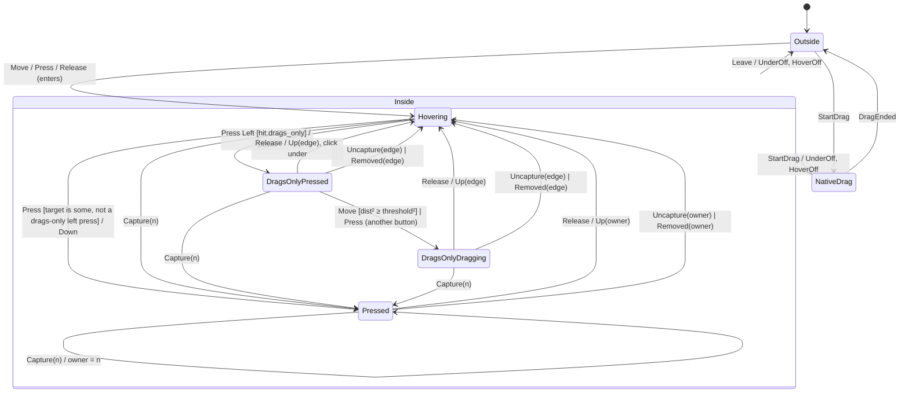

# `pointer`: hover, press, capture and compositor drags

Catalog: **KIT-13** (pointer hover, press and capture) and **UIW-01**
(press-then-release click pairing). Source at `8e0acbe5`:
`desktop/aizome/crates/aizome-kit/src/engine.rs` (`Win.hot`, `.hot_under`,
`.active`, `.press_under`; `update_hot` 1932–2024, `pointer_move`
2026–2053, `pointer_leave` 2055–2086, `pointer_button` 2088–2196,
`click_under` 2200–2216, `press` 2220–2265, capture 1674–1678, widget drag
1633–1638, `Core::start_drag` 2376–2386, modal filter 1898),
`widgets/controls.rs` (`ButtonWidget::event` 421–437 fires on any left
`PointerUp` inside its bounds), `widgets/interact.rs` (`mouse_area`: drag
threshold 4 px, `drag_out` → `Cx::start_drag`).

The machine is one window's pointer router. The engine hit-tests and
delivers; the machine decides **who gets what**. Hot path: every pointer
event in every Aizome app.

## Types

- `Node(u16)`, `Point { x, y }` (logical px, `i32`), `Button { Left, Middle, Right }`.
- `Hit { node, drags_only, under }`: the hit test at the event's point.
  `node` is the topmost node that reacts to the pointer (it is hovered and
  takes a press; `None` over inert background). `drags_only`: `node` takes
  only left drags (a column edge over rows). `under`: the node beneath a
  drags-only node. Helpers: `beneath()` = `under` if `drags_only` else
  `node`; `names(n)` = `node == Some(n) || under == Some(n)`.
- `Config { drag_threshold: i32 }` (default 4): a drags-only press becomes a
  drag once `dist²(at, press_at) >= threshold²`.

**Input domain** (the environment guarantees): valid hits (`drags_only` ⇒
`node.is_some()`; `under.is_some()` ⇒ `drags_only`; `under != node`).
Any event may arrive in any state.

## States and their data

`Inside` is a superstate. Its data is the hover pair, shared by every
substate:

| State | Data |
|---|---|
| `Outside` | none |
| `Inside` (superstate) | `hot: Option<Node>`, `under: Option<Node>` (hover beneath a drags-only `hot`) |
| `Hovering` | none (a button may be down, but nobody owns the press) |
| `Pressed` | `owner: Node` (took the press, or asked for a capture) |
| `DragsOnlyPressed` | `edge: Node`, `at: Point` (the press), `clicks: u8`, `beneath: Option<Node>` |
| `DragsOnlyDragging` | `edge: Node` |
| `NativeDrag` | none (the compositor owns the pointer) |

`StateName` is the leaf: `Outside`, `Hovering`, `Pressed`,
`DragsOnlyPressed`, `DragsOnlyDragging`, `NativeDrag`. There are no timers.

## Effects

`HoverOn(n)`, `HoverOff(n)` (hot changes), `UnderOn(n)`, `UnderOff(n)`
(hover beneath an edge), `Move { node, at }`, `Down { node, at, button,
clicks }`, `Up { node, at, button, inside }`. A control fires only on an
`Up` with `inside: true`, and `Up` reaches only the node that owns the press.

## Shared actions

**track(hit)**, the hover update:
1. `new_under = if hit.drags_only { hit.under } else { None }`. If it differs
   from `under`: `UnderOff(old)` if old is some, then `UnderOn(new)` if new is
   some.
2. `new_hot = hit.node`. If it differs from `hot`: `HoverOff(old)` if some,
   then `HoverOn(new)` if some.

**exit Inside** (on `Leave` and `StartDrag`): `UnderOff(under)` if some, then
`HoverOff(hot)` if some. Entering `Inside` from `Outside` starts with
`hot = under = None`.

## Transitions

"Owner states" are `Pressed`, `DragsOnlyPressed` and `DragsOnlyDragging`;
their owner is `owner` or `edge`.

| Event | State | Effects, in order | Next |
|---|---|---|---|
| `Move{at,hit}` | `NativeDrag` | none | same |
| | `Outside` | enter `Inside`, then as `Hovering` | |
| | `Hovering` | track(hit); `Move{hit.node, at}` if `hit.node` is some | `Hovering` |
| | owner state | track(hit); `Move{owner, at}` | same, except `DragsOnlyPressed` → `DragsOnlyDragging` when `dist²(at, press at) ≥ threshold²` |
| `Press{at,button,clicks,hit}` | `NativeDrag` | none | same |
| | `Outside` | enter `Inside`, then as `Hovering` | |
| | `Hovering` | track(hit); `target = if Left { hit.node } else { hit.beneath() }`; if some: `Down{target, at, button, clicks}` | none → `Hovering`; `Left && hit.drags_only` → `DragsOnlyPressed{edge: target, at, clicks, beneath: hit.under}`; else `Pressed{owner: target}` |
| | owner state | track(hit); `Down{target, …}` if target is some (same target rule) | owner unchanged; `DragsOnlyPressed` → `DragsOnlyDragging` (the click under is cancelled) |
| `Release{at,button,hit}` | `NativeDrag` | none | same |
| | `Outside` | enter `Inside`; track(hit) | `Hovering` |
| | `Hovering` | track(hit) (**no `Up` to anyone**) | `Hovering` |
| | `Pressed{owner}` | `Up{owner, at, button, inside: hit.names(owner)}`; then track(hit) | `Hovering` |
| | `DragsOnlyPressed{edge, at: p0, clicks, beneath}` | `Up{edge, at, button, inside: hit.names(edge)}`; if `button == Left` and `beneath` is some `b`: `Down{b, p0, Left, clicks}`, `Up{b, at, Left, inside: hit.names(b)}`; then track(hit) | `Hovering` |
| | `DragsOnlyDragging{edge}` | `Up{edge, at, button, inside: hit.names(edge)}`; then track(hit) | `Hovering` |
| `Leave` | `Inside` | exit Inside | `Outside` |
| | other | none | same |
| `Capture(n)` | `Inside` (any) | none | `Pressed{owner: n}` |
| | other | none | same |
| `Uncapture(n)` | owner state whose owner is `n` | none (no `Up`) | `Hovering` |
| | other | none | same |
| `StartDrag(_)` | `Inside` | exit Inside | `NativeDrag` |
| | `Outside` | none | `NativeDrag` |
| | `NativeDrag` | none | same |
| `DragEnded` | `NativeDrag` | none | `Outside` |
| | other | none | same |
| `Removed(n)` | `Inside` | none. Clear `hot`/`under` where they are `n`; owner state whose owner is `n` → `Hovering`; in `DragsOnlyPressed`, `beneath == Some(n)` → `None` | as said |
| | other | none | same |

Note the order: `Move` and `Press` track the hover **before** delivering;
`Release` delivers **before** tracking (as `pointer_button` does).

## Invariants

1. At most one node owns the press, and only in an owner state.
2. `NativeDrag` and `Outside` hold no hover and no owner.
3. `Up` is emitted only from an owner state, to its owner (or, for the click
   under, to the `beneath` recorded at the press).
4. A click under exists only in `DragsOnlyPressed`, and only for the edge
   that took the press (the current code's representable `press_under`
   naming another node is gone).
5. `under` is some only while `hot` is a drags-only node.

## Deliberate differences from the current code

- `StartDrag` from the program (`Cx::start_drag`) ends the press like the
  widget path (KIT-13), and both clear the hover (the compositor owns the
  pointer; the current code waits for `pointer_leave`).
- `Leave` ends every press, not only a drags-only one: the reasoning at
  `engine.rs:2066-2069` (while a button is down the pointer stays the
  window's, so a leave means the compositor took it) applies to all.
- A release with no owner delivers nothing (UIW-01); a node rebuilt away or
  uncaptured loses the press and its release.
- `Removed(n)` clears `n` from the hover (the current code leaves a stale
  `hot` until the next hit test).
- Simplified away: tooltips (KIT-17), the cursor, focus on press, menus
  closing on press, popups, scroll, the inspector, double-click counting
  (the platform's `clicks` passes through). A press's handler is the hit
  node (the current code bubbles `PointerDown` up the path and takes the
  first handler; the hit test stands for that result).

## Illegal operations (compile-fail probes)

Each probe is a use of the implementation's own API that the spec forbids.
Classify each per implementation as rejected at compile time, rejected at
runtime, or accepted (see `IMPLEMENTING.md`).

1. **P1 release-without-owner:** deliver an `Up` (a release) to a node while
   no press is owned (from `Hovering` or `Outside`). (UIW-01)
2. **P2 owner-after-native-drag:** read or route to the press owner after a
   compositor drag started (`NativeDrag` still naming the old owner). (KIT-13)
3. **P3 click-under-after-drag:** perform the click under from
   `DragsOnlyDragging` (after the press became a drag).
4. **P4 press-point-outside-edge-press:** read the press point or `beneath`
   in any state but `DragsOnlyPressed`.
5. **P5 hover-outside:** set a hovered node while `Outside` or `NativeDrag`.
6. **P6 owner-mismatch:** be in an owner state with no owner, or with a
   `beneath` but no drags-only owner.

## Confirmed-bug scenarios (traces, as the correct behaviour)

- **KIT-13** `program-started-drag-releases-the-press`: press a file icon,
  move, the program starts a compositor drag, the pointer leaves, the drag
  ends, re-enter over a button and click it. Correct: no move reaches the
  drag source after the drag starts, and the button gets its `Up` (repro:
  `repro/out/kit.md`, KIT-13: the click was lost to the stale source).
- **UIW-01** `release-without-a-press-fires-nothing`: press on inert
  background, move onto a button, release. Correct: no `Up` at all (repro:
  button, toggle, check and segmented control all fired).
- **UIW-01** `release-after-the-pressed-node-is-rebuilt-away` and
  `release-after-uncapture`: the same defect through the hazard paths
  (`engine.rs:1898`, `capture: Some(false)`).
