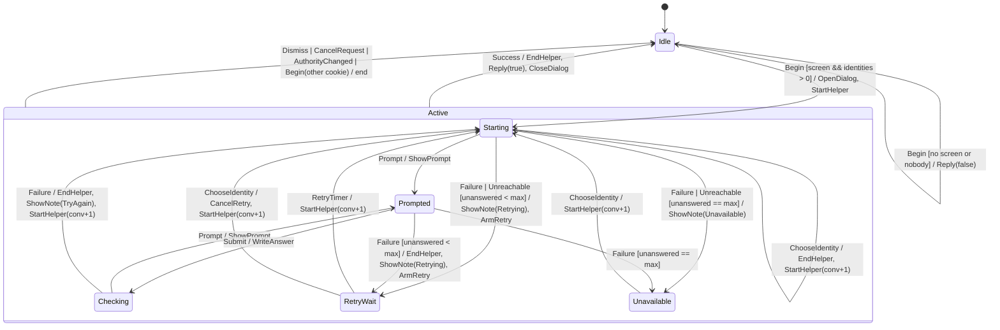

# `polkit`: authentication request, dialog and helper conversations

Catalog: **SYB-09** (polkit authentication session and helper conversation)
and **SHB-03** (polkit authentication dialog). Source at `8e0acbe5`:
`desktop/aizome/crates/aizome-sys/src/polkit.rs` (`SessionInner.reply`,
`.conversation`, `.generation` 195–202; `Session::start` 233–264,
`converse` 274–327, `respond` 329–334, `finish` 337–346;
`begin_authentication` 573–620 with the duplicate-cookie refusal 598–600;
`cancel_authentication` 622–640; `change_owner` 551–561) and
`desktop/aizome/crates/aizome-shell/src/auth.rs` (`AuthState` 58–68;
`auth_in` 237–301: Begin 241–273, no screen 246–249, Prompt 275–279,
Failed restarting at once 289–296; `auth_msg` 303–328).

One machine stands for the shell's dialog and the aizome-sys session behind
it: one request at a time (the shell shows one), conversations numbered by
`conv` (the current code's generation; `gen` is a keyword in edition 2024).
Every helper event names its conversation; only the current one counts.

## Types

- `Cookie(u32)`; conversation numbers `conv: u32` increase by one at every
  `StartHelper` over the machine's whole life (the first is 1).
- `Config { retry_base_ms: 500, max_unanswered: 3 }`;
  `retry_delay(n) = min(retry_base_ms * 2^(min(n,17) - 1), 60_000)` (saturating).
- `Note`: `PamError`, `PamInfo`, `TryAgain`, `Retrying`, `Unavailable`.

**Input domain:** any event in any state, with any conversation number or cookie.

## States and data

| State | Data |
|---|---|
| `Idle` | none |
| `Active` (superstate) | `cookie`, `identities: u8`, `identity: u8`, `unanswered: u8` (failures in a row with no answer given) |
| `Starting`, `Prompted`, `Checking` | `conv` (the running conversation) |
| `RetryWait`, `Unavailable` | none (no conversation runs) |

The machine-wide `last_conv: u32` survives requests. `unanswered` is reset
by a `Prompt` and by `ChooseIdentity`. A timer is armed only in
`RetryWait`.

Entry and exit actions: entering `Active` opens the dialog (`OpenDialog`);
leaving it closes the dialog (`CloseDialog`) after replying to polkitd.
Leaving `Starting`/`Prompted`/`Checking` other than to `Checking` or
`Prompted` ends the conversation (`EndHelper`), except after `Unreachable`
(no helper runs); leaving `RetryWait` other
than by its timer cancels the timer (`CancelRetry`). The tables below give
the resulting order explicitly.

## Actions

- **start(identity)**: `last_conv += 1`; `StartHelper { conv: last_conv, identity }`; → `Starting`.
- **end the request** (exit `Active` without success): `EndHelper { conv }`
  if in `Starting`/`Prompted`/`Checking`; `CancelRetry` if in `RetryWait`;
  then `Reply { cookie, authorized: false }`, `CloseDialog { cookie }`; → `Idle`.
- **back off** (an attempt failed before any answer): `unanswered += 1`; if
  `unanswered >= max_unanswered`: `ShowNote(Unavailable)` → `Unavailable`;
  else `ShowNote(Retrying)`, `ArmRetry { ms: retry_delay(unanswered) }` → `RetryWait`.

## Transitions

"Current" means the event's `conv` equals the running conversation's; any
helper event that isn't current, or arrives where no conversation runs, is
ignored.

| Event | State | Effects, in order | Next |
|---|---|---|---|
| `Begin{cookie, identities, preferred, screen}`, checked in this order | `Active`, same cookie | none (the agent refuses polkitd's duplicate) | same |
| | any, `identities == 0` | `Reply{cookie, false}` (the agent refuses it before the shell sees it; an open request goes on) | same |
| | `Active`, other cookie | end the request, then as in `Idle` | |
| | `Idle` | if `!screen`: `Reply{cookie, false}`. Else `OpenDialog{cookie}`, start(`preferred` if `< identities`, else 0) | `Idle` / `Starting` (`unanswered = 0`) |
| `CancelRequest{cookie}` | `Active` with that cookie | end the request | `Idle` |
| `AuthorityChanged`, `Dismiss` | `Active` | end the request | `Idle` |
| `Prompt{conv, echo}` current | `Starting`, `Checking` | `ShowPrompt{echo}`; `unanswered = 0` | `Prompted` |
| | `Prompted` | none | same |
| `PamError{conv}` / `PamInfo{conv}` current | `Starting`/`Prompted`/`Checking` | `ShowNote(PamError)` / `ShowNote(PamInfo)` | same |
| `Success{conv}` current | `Starting`/`Prompted`/`Checking` | `EndHelper{conv}`, `Reply{cookie, true}`, `CloseDialog{cookie}` | `Idle` |
| `Failure{conv}` current | `Checking` | `EndHelper{conv}`, `ShowNote(TryAgain)`, start(identity) | `Starting` |
| | `Starting`, `Prompted` | `EndHelper{conv}`, back off | `RetryWait` / `Unavailable` |
| `Unreachable{conv}` current | `Starting` | back off (nothing to end) | `RetryWait` / `Unavailable` |
| | other | none | same |
| `Submit` | `Prompted` | `WriteAnswer{conv}` | `Checking` |
| | other | none | same |
| `ChooseIdentity(i)` | `Active`, `i < identities` | `EndHelper{conv}` if a conversation runs; `CancelRetry` if `RetryWait`; `unanswered = 0`; start(i) | `Starting` |
| | otherwise | none | same |
| `RetryTimer` | `RetryWait` | start(identity) | `Starting` |
| | other | none (stale) | same |

## Invariants

1. A conversation runs exactly in `Starting`, `Prompted`, `Checking`, and it
   is the newest one started; events of older ones change nothing.
2. `WriteAnswer` only follows a shown prompt, once per prompt.
3. After a failure with no answer given, the next helper start waits for a
   timer, and after `max_unanswered` such failures in a row there are no
   automatic starts at all.
4. Every `OpenDialog{c}` is followed by exactly one `Reply{c, _}` and one
   `CloseDialog{c}`; no `Reply` is sent twice for a cookie.
5. The retry timer is armed only in `RetryWait`.

## Deliberate differences from the current code

- **The fix:** a failure before any answer (connect error, or the helper
  ending with no SUCCESS/FAILURE before the person answered) backs off and
  then gives up (SYB-09, SHB-03). A failure after an answer restarts at once
  as now (`auth.rs:289-296`).
- `Submit` only answers a shown prompt (the current code queues an early
  answer as the next prompt's, `polkit.rs:329-334`, and a Prompt clears
  `busy` while the helper checks).
- The races of the threaded code (a stale converse thread wiping a newer
  conversation, `start` holding the lock across `connect`) can't occur:
  events are serialized and checked by conversation number.
- Simplified away: the text of prompts and messages, the password itself,
  the identity list's contents, the agent registration loop (SYB-10), the
  dialog's window and output (the dead-window hazard is outside), the
  multi-session map (the shell shows one request).

## Illegal operations (compile-fail probes)

1. **K1 answer-without-prompt:** write an answer when no prompt is shown (in
   `Starting`, `Checking`, `RetryWait`, `Unavailable` or `Idle`).
2. **K2 stale-conversation:** apply a helper event of conversation `n-1` to
   conversation `n`.
3. **K3 restart-without-backoff:** start a new conversation straight from an
   unanswered failure (no `RetryWait`). (SYB-09/SHB-03)
4. **K4 double-reply:** reply to polkitd twice for one request, or after it
   ended.
5. **K5 retry-timer-outside-wait:** arm or act on the retry timer outside
   `RetryWait`.
6. **K6 conversation-after-unavailable:** start a conversation from
   `Unavailable` without the person choosing an identity.

## Confirmed-bug scenarios (traces, as the correct behaviour)

- **SHB-03** `unreachable-helper-backs-off`: the helper socket is missing;
  connect fails at every start. Correct: retries after 500 ms and 1 s, then
  `Unavailable`, no spinning (repro `repro/out/shell-b-sys-b.md`, SHB-03:
  500 restarts in 0.38 s). Also `choosing-an-identity-retries-by-hand`.
- **SYB-09** `helper-exits-without-a-verdict-backs-off`: the helper exits
  with no output and no prompt (repro: 200 helper processes in 0.27 s).
  Also `a-prompt-resets-the-count`, `waiting-retry-dismissed`,
  `identity-change-during-the-back-off`.
