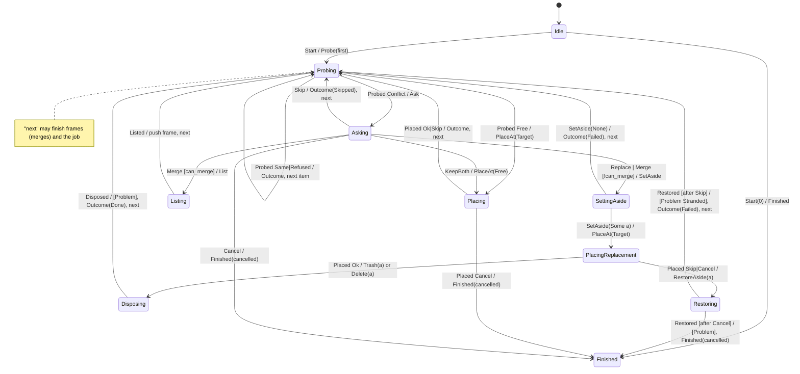

# `transfer`: placement with conflicts, merges and replace-aside

Catalog: **HAKO-05** (transfer placement with conflict prompt and
replace-aside protocol). Source at `8e0acbe5`:
`desktop/aizome/apps/hako/src/fsops/transfer.rs` (`transfer_items` 55–82,
`restore` 128–160 with `Worker { trash: None }` at 141, `duplicate` 42–53
with `None` at 52, `Worker` 276–281, `place_top` 355–446: conflict asked
401, KeepBoth 404–407, Merge 408–411, Replace 412–417, `set_aside` 449–461,
`dispose` 463–477 falling back to `remove_quietly` at 469, restore of the
aside on failure 430–441; `merge` 584–605), `names.rs` (`aside_name`
175–183, `is_temporary` 186–190), `undo.rs` (Undo of Move to Trash calls
`restore`, 167), `fsops/mod.rs` (`Conflict::can_merge` 60–62).

A sans-I/O job: every file-system step is an effect, and its result comes
back as an event naming the item. Folders merged into folders run the same
per-item machine on their children (a stack of frames).

## Types

- `ItemId(u32)`: top-level items are `0..items`; a merged folder's children
  are the ids its `Listed` names (the driver keeps ids unique).
- `AsideId(u32)`: the hidden name a replaced item was set aside under.
- `Config { mode: Copy|Move, kind: Transfer|Duplicate|Restore,
  delete_replaced: bool }`. `kind` says which operation built the job and
  must not affect behaviour; `delete_replaced` is the person's explicit
  choice of permanent deletion.
- `Found`: `Free`, `Conflict { can_merge }`, `Same`, `Refused`.
- `Resolution`: `Skip`, `Cancel`, `KeepBoth`, `Merge`, `Replace`.
- `Placed`: `Ok`, `Skip`, `Cancel`. `Outcome`: `Done`, `Skipped`, `Failed`.
- `Problem`: `KeptAside(aside)`, `Stranded(aside)`, `NotAllRemoved`.

**Input domain:** any event in any state, naming any item. Only the
response the current state awaits, for its current item, does anything.

## States and data

| State | Data |
|---|---|
| all but `Idle`/`Finished` | the frame stack: per frame `folder: Option<ItemId>` (None for the top), `next`, `end: ItemId`, `complete: bool` |
| `Probing`, `Placing`, `SettingAside`, `Listing` | `item` |
| `Asking` | `item`, `can_merge` |
| `PlacingReplacement`, `Disposing` | `item`, `aside` |
| `Restoring` | `item`, `aside`, `then: Failed | Cancel` |

No timers. Entry and exit actions: popping a merge frame (leaving a
folder's sub-machine) emits `RemoveEmptySource` (moves, when complete) and
the folder's `Outcome`; see **next**.

## Actions

- **next**: look at the top frame. If `next < end`: take `item = next`,
  `next += 1`, `Probe { item }` → `Probing { item }`. Otherwise pop it. A
  popped merge frame for `folder`: `RemoveEmptySource { folder }` if `mode ==
  Move && complete`, then `Outcome { folder, Done }`, then **next** again
  (the parent's `complete` is not changed). A popped top frame:
  `Finished { cancelled: false }` → `Finished`.
- **item done(item, o)**: `Outcome { item, o }`; if `o != Done` the top
  frame's `complete = false`; then **next**.
- **cancel**: `Finished { cancelled: true }` → `Finished` (frames dropped).
- **dispose**: `Delete { item, aside }` if `delete_replaced`, else
  `Trash { item, aside }`, → `Disposing`. Never decided by `kind`.

## Transitions

| Event (for the current item) | State | Effects, in order | Next |
|---|---|---|---|
| `Start { items }` | `Idle` | push the top frame `0..items`; next | `Probing` / `Finished` |
| `Probed { Free }` | `Probing` | `PlaceAt { item, Target }` | `Placing` |
| `Probed { Same }` | `Probing` | item done(Done) | |
| `Probed { Refused }` | `Probing` | item done(Failed) | |
| `Probed { Conflict { can_merge } }` | `Probing` | `Ask { item, can_merge }` | `Asking` |
| `Answered { Skip }` | `Asking` | item done(Skipped) | |
| `Answered { Cancel }` | `Asking` | cancel | `Finished` |
| `Answered { KeepBoth }` | `Asking` | `PlaceAt { item, Free }` | `Placing` |
| `Answered { Merge }`, `can_merge` | `Asking` | `List { item }` | `Listing` |
| `Answered { Replace }`, or `Merge` without `can_merge` | `Asking` | `SetAside { item }` | `SettingAside` |
| `SetAside { Some(a) }` | `SettingAside` | `PlaceAt { item, Target }` | `PlacingReplacement { a }` |
| `SetAside { None }` | `SettingAside` | item done(Failed) | |
| `Placed { Ok }` / `{ Skip }` | `Placing` | item done(Done) / item done(Failed) | |
| `Placed { Cancel }` | `Placing` | cancel | `Finished` |
| `Placed { Ok }` | `PlacingReplacement` | dispose | `Disposing` |
| `Placed { Skip }` / `{ Cancel }` | `PlacingReplacement` | `RestoreAside { item, a }` | `Restoring { then: Failed / Cancel }` |
| `Disposed { ok }` | `Disposing` | if `!ok`: `Problem { item, NotAllRemoved }` when deleting, `Problem { item, KeptAside(a) }` when trashing; then item done(Done) | |
| `Restored { ok }` | `Restoring` | if `!ok`: `Problem { item, Stranded(a) }`; then item done(Failed), or cancel | |
| `Listed { first, count }` | `Listing` | push frame `{ folder: item, first..first+count, complete: true }`; next | |
| anything else | any | none | same |

## Invariants

1. The user's original is never deleted unless `delete_replaced`: a
   replaced item is trashed, or kept aside (and reported) if the Trash
   refuses it, or put back if its replacement failed.
2. An aside exists exactly in `PlacingReplacement`, `Disposing` and
   `Restoring`, and each aside is disposed of or restored exactly once.
3. Only one request is outstanding at a time, for one item.
4. A moved folder is removed only after all its children arrived (and only
   if empty); a copied one never.
5. `Finished` is emitted exactly once.

## Deliberate differences from the current code

- **The fix (HAKO-05):** what happens to a replaced item depends only on
  `delete_replaced`, not on which caller built the `Worker` (`trash: None`
  in `restore` and `duplicate`).
- A Trash failure keeps the replaced item aside and reports it (the current
  code falls back to deleting it, `transfer.rs:465-469`).
- Simplified away: the ask-and-retry error loops inside each step (HAKO-07:
  a step's result already reflects them), copy/move mechanics (HAKO-06),
  progress, the pause/cancel checkpoint between items (HAKO-03), the
  "replace a folder it's inside" refusal, crash recovery of aside names.

## Illegal operations (compile-fail probes)

1. **T1 dispose-before-placed:** dispose of (trash or delete) the set-aside
   item before its replacement is in place.
2. **T2 dispose-by-kind:** decide trash versus delete from the job kind
   rather than the person's choice (e.g. delete in a `Restore` job without
   `delete_replaced`). (HAKO-05)
3. **T3 lost-aside:** leave `Restoring`/`Disposing` without restoring or
   disposing of the aside (dropping the `AsideId`).
4. **T4 place-without-answer:** place over a conflicting target without the
   person's answer.
5. **T5 response-for-other-item:** apply a response for item `j` while
   awaiting item `i`'s.
6. **T6 merge-non-folders:** start a merge (list children) when the
   conflict can't merge.

## Confirmed-bug scenarios (traces, as the correct behaviour)

- **HAKO-05** `put-back-replace-goes-to-the-trash`: Put Back (and Undo of
  Move to Trash) with Replace at the conflict: the newer item is trashed,
  not deleted (repro `repro/out/hako.md`, HAKO-05: the Trash held nothing
  and the report was clean). Also `put-back-merge-replaces-into-the-trash`
  (the same inside a merge).
