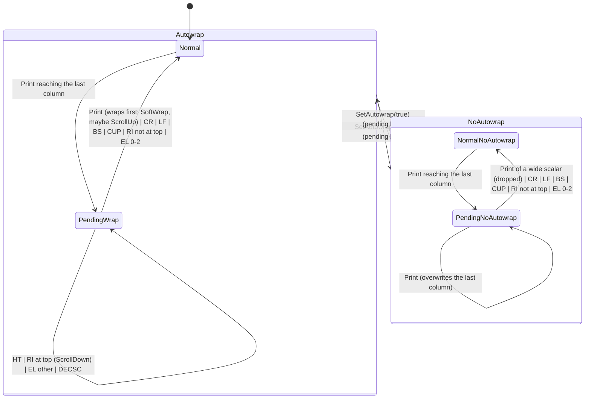

# `wrap`: pending wrap, autowrap and soft-wrap row links

Catalog: **HCO-12** (pending wrap and soft-wrap row linkage). No confirmed
bug: the traces follow Hotaru's observable behaviour. Source at `8e0acbe5`:
`apps/hotaru/crates/hotaru-core/src/screen.rs`: `Screen.wrap_pending`
(175), `State.autowrap` (702), `State.previous_char` (696), `SavedCursor`
(118); `prepare_wrap`/`wrap` (1129–1154); the full-width `print` (2267–2353)
and `print_ascii` (1069–1127, the same rules for runs); controls in
`execute` (2354–2398) and `esc` (2400–2450: IND, NEL, RI); CUP family
`move_to` (1672–1687); EL (2731–2775, links broken at 2740–2748); REP
`print_repeat` (1643–1665, `CSI b` default 1 at 2599); DECSC/DECRC
`save_cursor`/`restore_cursor` (1853–1880); `linefeed` (356–371),
`carriage_return` (397–404); DECAWM `autowrap = set` (2005); RIS.

The hottest target: evaluated per printed cell. Effects go to a generic
sink so that benchmarks don't measure `Vec` pushes.

## Types

- `Config { cols, rows }`: `cols >= 2`, `1 <= rows <= 128`.
- Events: `Print { wide }`, `Repeat(n)`, `CarriageReturn`, `LineFeed`,
  `Backspace`, `Tab`, `CursorTo { row, col }`, `ReverseIndex`,
  `EraseLine(mode)`, `SetAutowrap(bool)`, `SaveCursor`, `RestoreCursor`,
  `FullReset`.
- Effects: `Put { row, col, wide }`, `SpacerHead { row, col }`,
  `SoftWrap { row }`, `ScrollUp`, `ScrollDown`, `Unlink { row }`.

**Input domain:** any event in any state; `CursorTo` may name positions off
the screen (clamped).

## States and data

Two orthogonal flags make the four `StateName`s: `pending` and `autowrap`.
Machine data (all states): cursor `row`, `col`; `saved: (row, col,
pending)`, initially `(0, 0, false)`; `previous: Option<wide>` (REP's
memory); `links`: for each screen row, whether it is soft-wrapped into the
next (the current code's `Row.wrapped` plus the next row's
`wrap_continuation`, kept as one bit per row). No timers, no entry or exit
actions.

## Transitions

Helper **linefeed**: `pending = false`; if `row == rows - 1`: `ScrollUp`,
and every link moves up a row (row 0's leaves with it); else `row += 1`.

Helper **print(wide)**:
1. `previous = Some(wide)`.
2. If `pending`: `pending = false`; if `autowrap`: `SoftWrap { row }`, link
   `row`, linefeed, `col = 0`. (Without autowrap the cursor stays: the
   print overwrites the last column.)
3. If `wide && col + 1 >= cols`: with `autowrap`: `SpacerHead { row, col }`,
   `SoftWrap { row }`, link `row`, linefeed, `col = 0`; without it the
   scalar is dropped (stop here; `pending` stays false).
4. `Put { row, col, wide }`; `col += width`; if `col >= cols`:
   `col = cols - 1`, `pending = true`.

| Event | Effect on the data | Effects |
|---|---|---|
| `Print { wide }` | print(wide) | as print |
| `Repeat(n)` | if `previous` is some: print it `max(n, 1)` times | as print, each time |
| `CarriageReturn` | `col = 0`, `pending = false` | none |
| `LineFeed` | linefeed (column unchanged) | `ScrollUp` at the bottom |
| `Backspace` | `col = col.saturating_sub(1)`, `pending = false` | none |
| `Tab` | `col` = the smallest multiple of 8 in `col+1 ..= cols-1`, else `cols - 1`; **`pending` kept** | none |
| `CursorTo { row, col }` | clamp both to the screen; `pending = false` | none |
| `ReverseIndex` | at `row == 0`: scroll down, links move down a row (the bottom row's is lost, row 0 has none), **`pending` kept**; else `row -= 1`, `pending = false` | `ScrollDown` at the top |
| `EraseLine(m)` | `m > 2`: nothing (pending kept). `m == 0 or 2` and `row` is linked: unlink it. Then `pending = false` | `Unlink { row }` when it unlinked |
| `SetAutowrap(on)` | `autowrap = on` (pending kept) | none |
| `SaveCursor` | `saved = (row, col, pending)` | none |
| `RestoreCursor` | `(row, col, pending) = saved` | none |
| `FullReset` | everything back to the initial values (autowrap on, no links, no `previous`, `saved` reset) | none |

## Invariants

1. `pending` implies `col == cols - 1`.
2. `col < cols`, `row < rows`.
3. A `SoftWrap { row }` is always followed (after an optional `ScrollUp`) by
   writing on the next row; a linked row's link is only removed by EL 0/2,
   by scrolling off the screen, or by RIS.
4. Without autowrap no `SoftWrap` or `SpacerHead` is emitted.

## Simplified away

Left/right margins (DEC 69) and scroll regions (full-screen margins only),
grapheme clustering and width-0 scalars, insert mode, origin mode, LNM,
charsets, style and hyperlinks, the alternate screen, resize and reflow
(the resize hazard in HCO-12 is outside), ED/ICH/DCH/IL/DL/ECH, DECALN,
history. Tab stops are fixed at every 8 columns.

## Illegal operations (compile-fail probes)

1. **W1 pending-off-the-edge:** set the pending wrap with the cursor not in
   the last column.
2. **W2 wrap-without-autowrap:** emit a soft wrap (or spacer head) while
   autowrap is off.
3. **W3 clear-on-tab:** clear the pending wrap on HT (HT must keep it).
4. **W4 print-while-pending:** write a cell while a wrap is pending without
   resolving it first (wrap, or clear it when autowrap is off).
5. **W5 dangling-link:** mark a row soft-wrapped without moving to the next
   row (the continuation).

## Confirmed-bug scenarios

None (HCO-12 lists hazards only: resize and IL/DL, outside this model).
